# 低延时视频图传系统：客户端模块说明

## 系统全貌

这是一套面向嵌入式设备远程监控的低延时视频图传系统，用 C\+\+17 写的，分服务端和客户端两个程序。**服务端叫 sserver**，常驻运行在 RK3576 开发板或任意 Linux 机器上，职责是把摄像头画面采出来、编成 H.264 或 H.265、推到网络上；在 RK 板子上它能走 DMA\-BUF、RGA、MPP 组成的全硬件零拷贝链路，CPU 几乎不参与像素搬运，在普通 Linux 上退化为 x264 软件编码。**客户端叫 sclient**，是 Qt6 写的跨平台程序，Linux、Windows、macOS 都能跑，职责是连上服务端、协商好参数、收流、用 FFmpeg 解码、用 OpenGL 渲染。两个程序各自是一个独立 CMake 工程，并排放在 media 目录下，模块结构、日志格式、二进制线格式保持对应，联调时两边能一一对应。

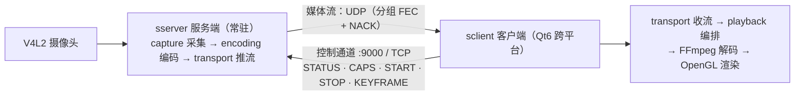

服务端是常驻的，媒体空闲时监听控制端口（默认 9000）等客户端来。客户端连上来先走一条自己设计的文本控制协议，命令一共五个：**STATUS** 查目标会话兼续租，**CAPS** 查服务端支持什么档位，**START** 选好传输方式和画质档位正式启动，**STOP** 停止，**KEYFRAME** 要一个关键帧。服务端收到 START 才把采集和编码的管线拉起来。多个客户端可以同时观看，同设备兼容请求共享采集，同档位共享编码，媒体只用 UDP；传输按加密、自动画质和网络策略决定独享或复用，有人退出归还自己的引用，相关资源无人使用才停止。控制连接上限 16 个，会话上限 8 个。

一次完整的取流交互是这样的：

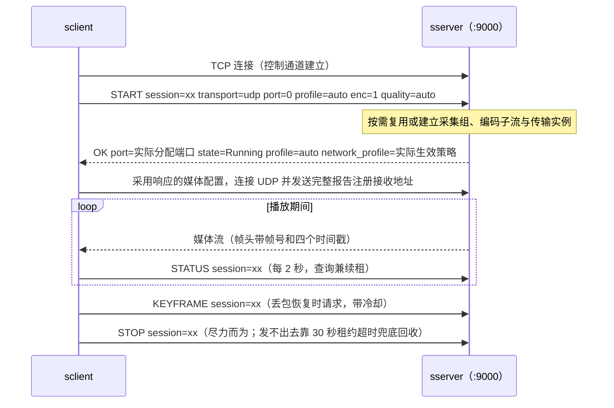

媒体传输当前只有 UDP，TCP 用于控制；UDP 要自己做分片和丢包恢复，这一部分包含分片、纠错和重传处理。画质档位叫 media\_profile，有六个主档位，各配一个子档位，本质是"采集格式乘编码后端"的组合：最低配的 yuyv\_x264 是 640×480、25 帧、800 kbps 的软编档，任何 Linux 都能跑；mjpeg\_x264 优先请求 1080p、30 帧 MJPEG，也可回退尺寸或 YUYV，再经对应预处理由 x264 编码，2\.5 Mbps 码率，是软件链路里的高清对照档；yuyv\_mpp 和 mjpeg\_mpp 两档在 RK 板子上分别用 700 kbps 和 2\.5 Mbps 的硬件编码，首个档位采用硬件采集路径时可走 DMA-BUF。另有 yuyv_h265、mjpeg_h265 两个 MPP H.265 主档位。采集编码档位由服务端配置决定，客户端用 quality 选择主流、子流或自动画质。UDP 下有自动网络策略和三档固定弱网策略：balanced 用 1200 字节的大分片加重传；adaptive 用 1000 字节分片，加重传加分组前向纠错；resilient 用 256 字节的小分片加全套恢复，给最差网络用。客户端默认请求 profile=auto，固定策略仍可由命令行选择；服务端回显请求 profile，自动模式另以 network_profile 回显实际策略，客户端按确认的请求模式装配本地接收策略。

整套系统按低延迟优先设计，需要限制旧帧积压：**实时观看优先显示最新帧，旧帧排队会增加延迟**。所以从服务端到客户端，各环节使用较小容量的队列，满了就丢最旧的帧；弱网下宁可降画质、丢帧、黑屏一下，也不让延迟涨上去。后面会分别介绍各模块的队列和丢帧处理方式。

下面依次介绍客户端 12 个模块，最后说明双端如何配合。

## 客户端 sclient 的 12 个模块

客户端 12 个模块同样自底向上单向依赖，playback 组织各能力模块，组成播放链路：

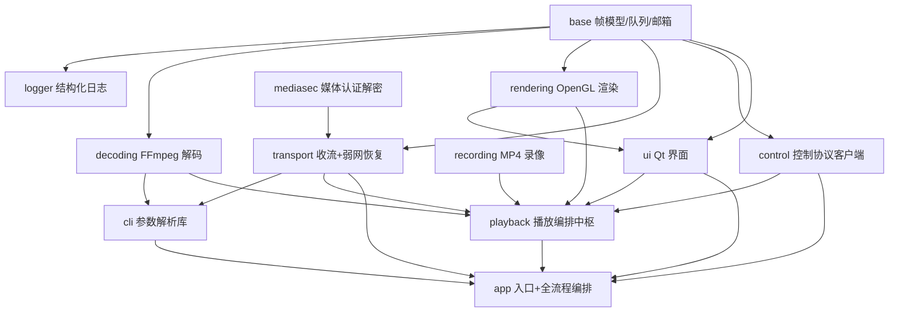

### base：公共类型

客户端的 base 跟服务端同构，但对象换了：这里流动的是解码后的画面而不是码流。**解码帧模型**带宽度、高度、像素格式（当前渲染支持 YUV420P 或 NV12，macOS 硬解也可直接携带平台图像）和四个平面的数据指针与行距，内存生命周期挂在一个类型擦除的共享指针上——它通常指向 FFmpeg 帧的克隆，引用清零自动释放，与服务端原始帧的租约机制相同：通过共享引用管理生命周期，最后一个持有者释放后回收资源。

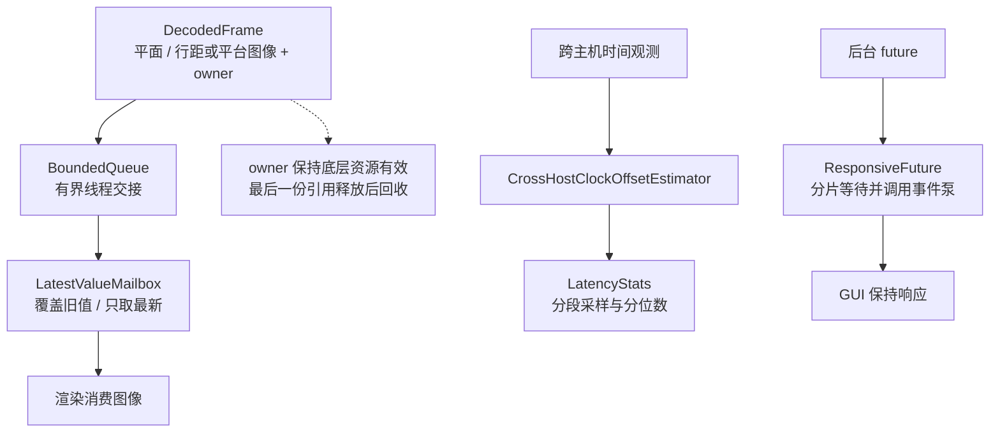

并发工具有几件。**有界队列**跟服务端同款：满时丢最旧、生产者永不阻塞，提供阻塞式带超时的取出和尝试取出，关闭时唤醒所有等待者。**单槽邮箱**是客户端特色的工具：只有一个槽位，发布新值直接覆盖旧值、取走即清，没有任何排队——它是"只保留最新一帧"这个策略的载体，渲染提交往里放帧、绘制事件从里取帧，中间的帧直接被覆盖掉，永远拿最新的。客户端各级队列都采用类似的处理方式：解码队列容量 1、渲染单槽邮箱，每一跳都在收窄。**延迟统计器**是环形缓冲的采样统计，最近值、平均值、p50、p95、p99、最大值，非线程安全，由调用方自己同步——工具不假装自己管并发。**跨主机时钟偏移估计器**解决一个真实问题：两台机器的单调时钟零点不一样，直接拿发送时间戳减本地时间没有意义。它用会话内最小的"接收减发送"差来估两端偏差——最小值最接近纯传播时延、没被排队污染；还能检测时钟跳变，跳了就通知相关统计复位重来。所以文档里写明：跨机的端到端分段仅供参考，重点看不依赖对时的接收侧内部分段。另有一个"带事件泵的等待"工具：等后台线程的结果期间持续处理界面事件，界面不冻结——它是客户端里唯一同步等待边界的标准解法，被多处复用。帧诊断工具与服务端同款思路，扫描码流载荷、跳过参数集前缀找第一个视频 NAL 判断是否含关键帧，重同步等待期间的日志判断靠它。

### logger：结构化日志

跟服务端同一套设计的客户端版本：同样的 logfmt 键值对、同样的组件加事件加会话号的格式、同样的轮转策略（单文件 10MB、保留 5 个）、同样的按起止时间定稿文件名，错误级别额外打到标准错误。多一个调试级别的事件接口。两边使用相同格式，便于联调时对照：同一次播放，两边的日志能按时间线拼在一起看，可以对照发送和接收事件的先后关系。

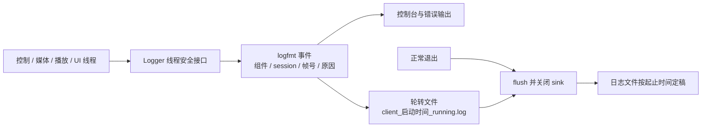

### transport：收流和弱网对抗

这个模块负责接收视频流并处理丢包与抖动。对外只有一个门面类，暴露连接、收帧、关闭三个同步方法、一个查询本地绑定端口的方法，外加一个输出队列的水位统计结构。实现完全藏在后面——上层代码从头到尾接触不到任何 Qt 的 socket 对象，这样可以隐藏网络实现：换网络库的改动收敛在这一个模块。

**线程结构是本模块的第一个要点。** 连接时启动一条内部输入输出线程，连接过程会等它就绪，最多等到超时加 1 秒——起线程或 socket 初始化失败都能干净地失败。这条线程只运行 UDP 数据报循环，**所有 socket 都在这条线程的栈上创建、空闲收包时等待最多 10 毫秒、发送、销毁**。这样处理是因为 Qt 的对象有线程亲缘性——一个 socket 创建在哪个线程，它的事件处理就绑死在那个线程，跨线程直接调它是未定义行为，这是 Qt 网络对象的线程使用限制。把 socket 的整个生命周期收敛到单线程之后，连发送都不需要锁了：保活包和重传请求都在同一条线程上顺序发送。完整帧出来之后，经过一个双上限的有界队列交付给上层——帧数上限 16、初始字节预算 8 MiB（大帧可抬高预算），超限时丢最旧——上层调用收帧方法就是从这个队列里取，队列的水位和丢弃计数随时可查，统计面板上"输出队列"那一组数字来自这里。抖动缓冲的策略参数在装配阶段注入：默认 profile=auto 使用低延迟 low，固定三档分别映射 auto、adaptive、smooth 等接收策略。

**UDP 侧是弱网对抗的核心，恢复分四层，一层比一层代价大，每层都有自我保护**——因为恢复流量自己不能比丢包造成更大的伤害：

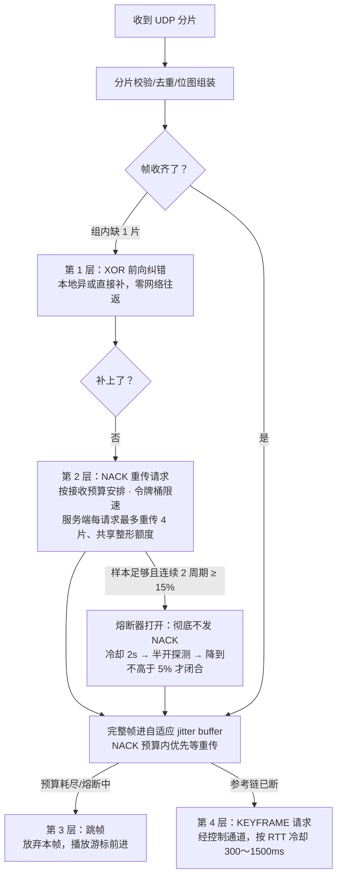

展开说。每个还没收齐的帧有一个组装记录，使用一张**分片位图**记录已收到和缺失的分片。数据报进来先认证解密、再做长度和范围校验、按片序号去重、填进位图。缺片了先试**前向纠错**：同一帧数据片按片号对实际组数 G 取余交织分组，每组异或出一个校验片；组内缺一个数据片时，用该组校验片和其余数据片异或补出来——数学上等于在二值域解线性方程，n 个未知数要 n 个方程，缺两片就无解，所以每组单异或只能补一片；不同组的缺片可以分别恢复，同组多缺片或校验也丢失时交给重传处理。异或的实现按 64 位字宽做，不是逐字节。

纠错补不了就发**重传请求**，节奏有很多层克制：默认自动模式缺片先压 5 毫秒再请求，这个延迟是给乱序晚到的包留的——包晚到一点不算丢；自动模式每帧最多请求 1 次、间隔 15 毫秒；多个帧的缺片聚合成一个包发，一包最多 4 项，全局还有每秒 8 包的令牌桶。这些时间参数要与总预算配合：默认自动模式缺帧等待最多 30 毫秒，预计重传赶不上就不请求；固定策略且 RTT 未知时仍用请求延迟 30 毫秒、2 次尝试和 50 毫秒间隔，约 130 毫秒，RTT 已知时动态调整。这个预算同时约束抖动缓冲里"等重传还是跳帧"的判定——收包和恢复使用相同的等待预算，不会出现抖动缓冲已经放弃跳帧了、重传侧仍在等待的情况。服务端那侧的配合在 transport 服务端模块讲过：每请求最多四片、共享整形额度、绝不阻塞。

**抖动缓冲**的 auto 策略是个三模式状态机，默认网络 profile=auto 则使用目标最多 20 毫秒的 low 策略：直通（收到了立刻交）、低延迟、平滑（主动引入十几到几十毫秒的驻留，用等待换完整帧），按抖动分位数、丢包率和跳帧率自适应切换，带防乒乓的滞后——网络在临界状态来回抖时，模式不能跟着抖。跳帧和等待按以下方式处理：**跳帧的代价远高于等一次大概率能到的重传**，因为跳帧后解码器要清空参考链等下一个关键帧，期间画面可能停在上一幅有效图像；所以重传预算内优先等，预算耗尽或者熔断开着根本没得等，才立即跳帧。计算出的目标延迟有硬上限，抖动再大也不会把等待无限放大。**熔断器**用于限制高丢包时的重传流量：统计最近 2 秒的分片丢包率，样本足够且连续 2 个周期达到 15% 就打开，彻底不发重传请求——丢包严重时，继续重传会增加链路负担，因此暂停重传，由纠错和跳帧维持播放；冷却 2 秒后进半开状态，每 500 毫秒放一次探测请求，样本足够且连续两个周期不高于 5% 才完全闭合。统计里还区分了发送尝试、成功、失败、被限速和被熔断抑制的——排查时分得清"没发"和"发了没到"，两种情况的处理方向完全不同。超时的未完成帧组装会被定期剪枝，防止坏帧记录堆积。

### mediasec：先认证，再处理媒体协议

mediasec 与服务端对称实现 AES-256-GCM。transport 在媒体协议解析前认证并解密报文，认证失败丢弃整包；上行保活、报告与 NACK 使用对应方向材料加密。

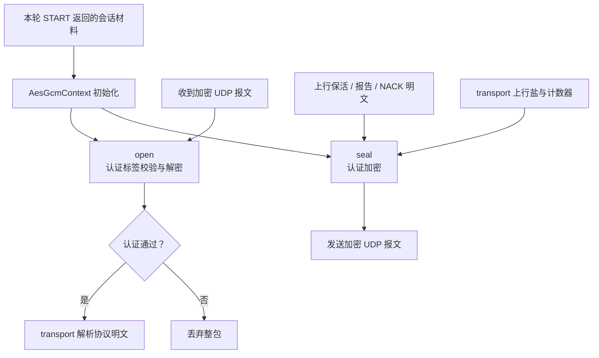

客户端默认请求加密。若 START 成功却没有合法、匹配本会话的密钥，连接失败，不自动退为明文；CLI 的 `--no-media-encryption` 才会显式关闭请求。同密钥重挂媒体连接保留上行计数器，新的 START 密钥则使用新上下文，避免复用 nonce。

### control：控制协议客户端

这个模块分为同步命令客户端和异步管理会话两层，负责可靠地发送、接收和校验文本命令。

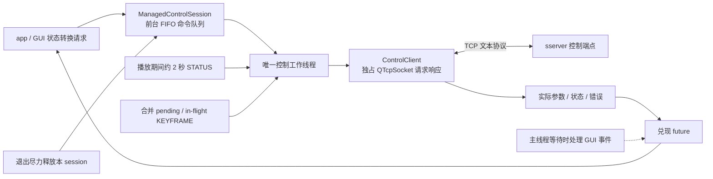

**下层是个同步的命令客户端**：连接、发命令行、按行等响应、解析成结构化结果。播放所需的 START、STATUS、STOP、KEYFRAME 都有，另外专门做了一批"尽力而为"的变体——停止、要关键帧、保活、释放会话都提供尽力版：失败只记一条日志、绝不抛错，专门用于退出路径——退出时需要限制命令等待，避免一条命令超时阻塞收尾，这些变体用于限制退出阶段的等待。响应解析会取出实际端口、实际生效的档位、实际 codec、设备和错误码这些字段，跟服务端"响应带全套状态"的设计呼应。常规单次命令默认超时 5 秒，连接最多尝试 5 次，以 400 毫秒为基数线性退避。

**上层是常驻的管理会话**：构造时就起一条工作线程，所有操作被包装成命令对象排进队列串行执行——为什么必须串行？因为命令之间有依赖（先连接才能发启动，启动成功才能要关键帧），并发执行就得处理一堆交错状态，串行队列按顺序执行，避免这些状态交错。每个操作对上层返回异步期约，UI 线程等结果的时候用事件泵轮询——每隔 10 毫秒处理一轮界面事件再回来看一眼结果，界面保持响应，这是客户端里唯一需要同步等待的边界，标准解法就是开头讲的那个事件泵工具。管理会话还提供三个功能：**播放期间自动保活**——进入播放态开始，每 2 秒自动发一次状态查询，兼做续租，正好对应服务端 30 秒的租约，就算偶尔丢一两次也远够；**关键帧请求的非阻塞与在途合并**——请求是异步投递的，而且一次请求还在路上时，后续的请求直接合并进去不重复发，丢包风暴时解码线程可能连续触发，合并保证不会把控制通道刷爆；**显式会话释放**——START、STATUS、STOP、KEYFRAME 都带 session，退出只尽力释放本会话，不回退全局 STOP；START 响应丢失也记住待释放对象，释放失败由服务端在租约超时后回收。

### decoding：FFmpeg 解码

解码模块是 FFmpeg 的封装，客户端统一的视频解码门面。接口很标准：初始化时按实际 codec 打开 H.264 或 H.265 解码器，后端选择有“自动、软件、硬件”，自动模式优先硬解，初始化失败可回退软解；喂数据取帧用的是解码器标准的拉式接口——送进一个压缩包、取出解码后的画面；有两种取法，一种只取最后一帧（适合一次喂一帧取一帧的常规路径），一种按显示顺序把一帧产出全部交出来（处理解码器内部的帧重排序延迟，保证双向预测帧的输出顺序正确）；还有一个**刷新方法**，内部调 FFmpeg 的清空缓冲，把解码器里残留的参考帧全部丢掉。

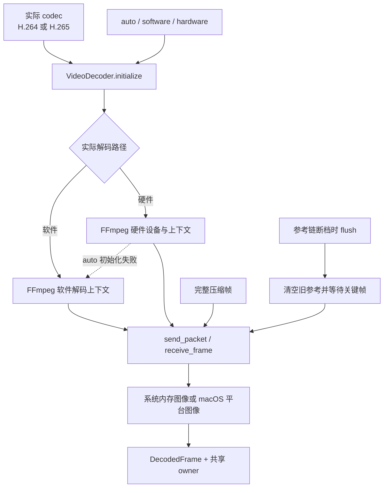

那个刷新方法存在的理由，是断档重同步的关键一环：网络断档之后，解码器里残留的参考链已经不可信，不清掉的话，下一个关键帧来了也可能跟旧状态搅在一起解出脏画面——所以重同步的标准动作是"先刷新、再丢普通帧、等关键帧从头建链"。系统内存输出保留实际像素格式，当前渲染支持 YUV420P/NV12，macOS 硬件路径也可直接输出平台图像，**模块内不做 CPU 逐像素 RGB 转换**——转换放到显卡上做，这是客户端延迟设计的一部分。帧数据通过克隆加共享指针的方式零拷贝出模块，上层拿到的解码帧的内存生命周期自动管理。

模块还提供一组名称稳定的诊断字段：最后一次错误的错误码、出错阶段（是喂包时错还是取帧时错）、FFmpeg 的原始错误码——字段名稳定、可 grep，解码失败时一条日志就能定位到阶段。刚连接时会有一种正常情况：刚连上还没拿到关键帧时，FFmpeg 会报"引用了不存在的参数集"之类的错误，这是正常的——没有关键帧带的参数集，解码器自然解不了普通帧，第一个关键帧到了画面出来就自愈。FFmpeg 解码类型仍封装在本模块中，上层通过解码接口使用；现在 recording 也独立链接 FFmpeg 做封装。

### rendering：OpenGL 渲染

渲染模块只管把解码帧画出来，不管窗口布局和交互，那是界面模块的事。应用先设置 OpenGL 3.3 核心 profile，门面按 vsync 选项初始化，然后交出一个可以嵌进窗口的可绘制控件；实现类是一个 Qt 的 OpenGL 部件，同时继承了 3\.3 核心的函数集。

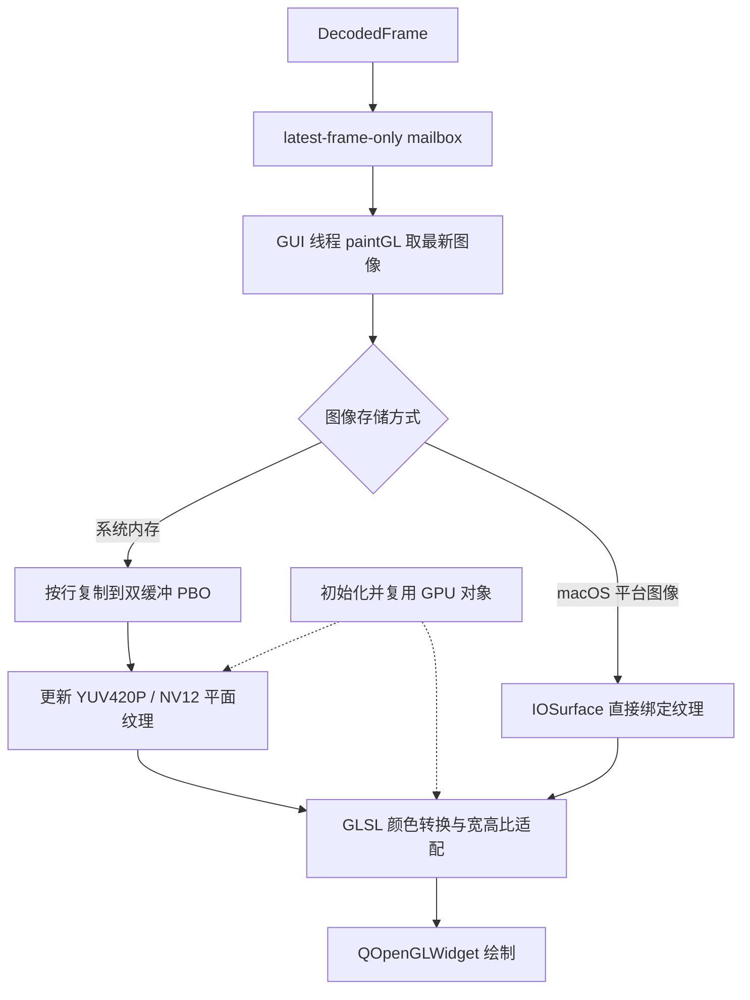

**系统内存图像的渲染路径是一条直线，全部发生在 UI 主线程**：解码帧先发布进一个单槽邮箱——新帧直接覆盖还没来得及渲染的旧帧，这是"要最新不要排队"在渲染前的最后一跳；绘制事件到来时从邮箱取走最新值；然后用 **PBO 双缓冲**上传纹理——6 个像素缓冲对象，对应画面的 3 个平面、每平面 2 个轮换：CPU 往当前这一组缓冲映射出的内存里写数据的同时，显卡从上一组缓冲往纹理搬运，写和传并行，渲染线程不用干等上传完成；最后在片元着色器里做 YUV 到 RGB 的颜色转换和宽高比缩放，一个绘制调用出图。这样处理是因为 1080p 的 YUV 数据每秒几十 MB，CPU 逐像素转换既吃核又加延迟，放到着色器里就是几次采样加一个矩阵乘，**CPU 不做逐像素 RGB 转换**——服务端的 RGA 硬件转换也采用相同的处理方式：颜色转换交给专用硬件。

两种输入格式两条路：YUV420P 是三个独立平面，用三个单通道纹理；NV12 的 UV 色度是交织在一个平面里的，用一个单通道加一个双通道纹理就够，着色器里用统一变量切换颜色模式，不用重编着色器。所有 GPU 资源——着色器程序、顶点数组、顶点缓冲、纹理、PBO——初始化时一次性建好，每帧只更新内容，分辨率变了才重新分配，对象本身不销毁重建：每帧创建销毁 GPU 对象既慢又容易留下状态泄漏，因此在 OpenGL 中保留这些对象，只更新内容，减少重复创建和销毁的开销。着色器源码以资源文件形式编进程序，顶点着色器算宽高比缩放、片元着色器做标准亮色度到 RGB 的矩阵转换。显示帧率按绘制事件的间隔估算出来，供统计面板显示。模块不自建工作线程，提交帧和绘制都在 UI 线程，邮箱是逻辑上的交接点。macOS 硬件图像还可经 IOSurface 直接导入纹理，不走 PBO 上传。

### recording：原码流 MP4 与独立写盘

recording 的 `Mp4Recorder` 接收完整压缩帧，独立线程写盘。入口在 playback 接收线程、进入解码队列之前，因此显示或解码队列丢弃图像，不会减少已经收到并交给录像的压缩帧。

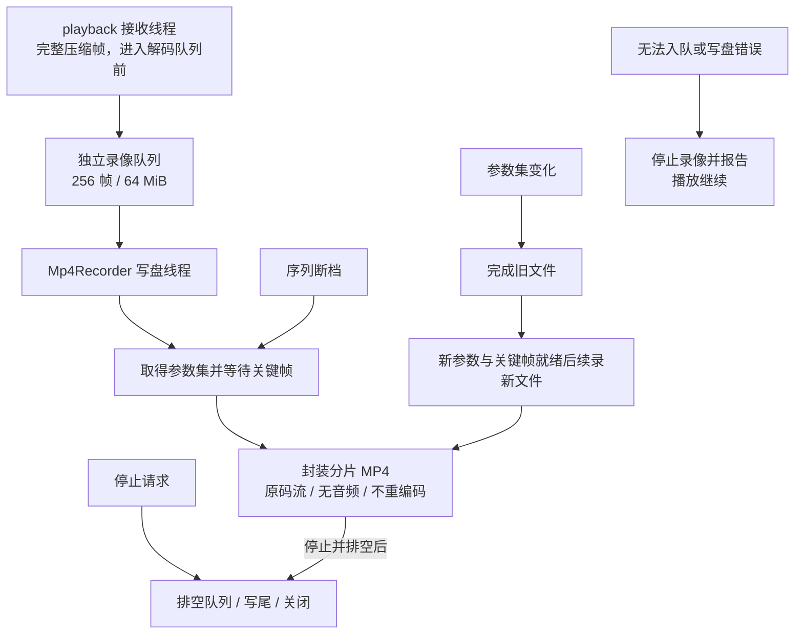

录像不重新编码，不含音频。开始时等待 H.264 的 SPS/PPS 或 H.265 的 VPS/SPS/PPS 及关键帧，再建立分片 MP4。时间戳优先取采集时间，没有时用接收时间；PTS=DTS 基于项目无 B 帧的约定。

队列预算为 256 帧、64 MiB，新帧无法入队时停止录像并报告错误，播放继续。录像不会为了跟上显示随意丢压缩帧；序列断档后等待下一随机接入点，网络没有恢复出来的内容无法补回。

参数集变化时完成旧文件，在新参数和关键帧就绪后续录到带序号的新文件；缺帧而参数不变时可在原文件内等待恢复。用户手动切换观看会结束本次录像，不能把参数变化续录理解为任意断线和换设备都会自动续录。`stop()` 发出结束请求后还要排空已入队帧、写尾并关闭，退出时会等待收尾。

### ui：Qt 界面

界面模块是窗口外壳，门面类包住一个主窗口，对外暴露的门面方法就是界面全部的能力：初始化（把渲染模块交出的控件嵌进窗口中央）、配置连接面板、取走用户的连接请求、更新连接面板状态、刷统计、轮询按键、更新窗口标题、关闭。视频控件仍在中央，连接和统计位于右侧停靠面板。**连接栏**：控制地址和端口、设备、画质、连接按钮和状态标签，窗口使用自动网络策略。**统计坞**是九组标签：传输方式、分辨率、帧率、六段延迟、解码、队列、抖动、丢包、恢复，数据由播放层每 100 毫秒刷进来，承载它的数据结构里装着六段延迟摘要加抖动、重传、纠错、队列水位、丢包率这一整套快照。右侧还有暂停、截图和录像请求及相应状态，像素绘制和录像写盘仍由对应模块处理。

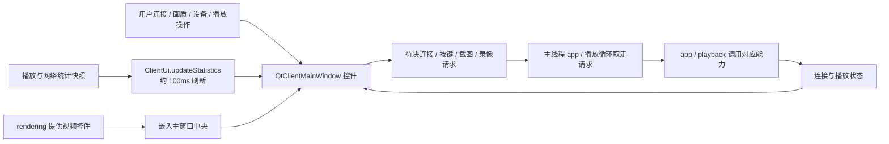

**所有跨线程交互都通过"待决请求队列"处理**。用户点连接产生一个待决的连接请求结构，按键进待决按键队列，主线程的播放循环每一帧轮询取走处理——工作线程从来不直接碰控件，界面状态全部由主线程单方面推。这样可以避免两类问题：跨线程直接操作控件（未定义行为）和大量跨线程信号槽（可以运行，但时序难以分析）。统计面板使用 100 毫秒刷新间隔——逐帧刷新统计本身就把渲染拖慢了，120 个标签每秒刷新 30 次，用户难以读完这些变化，还会增加刷新开销。

### cli：命令行解析库

名字容易误会，要先澄清：**cli 不是命令行播放器、不是第二个入口**，它是一个共享的参数解析库。主程序和 UDP 抖动基准工具都链接它，共用同一套参数定义和用法说明。

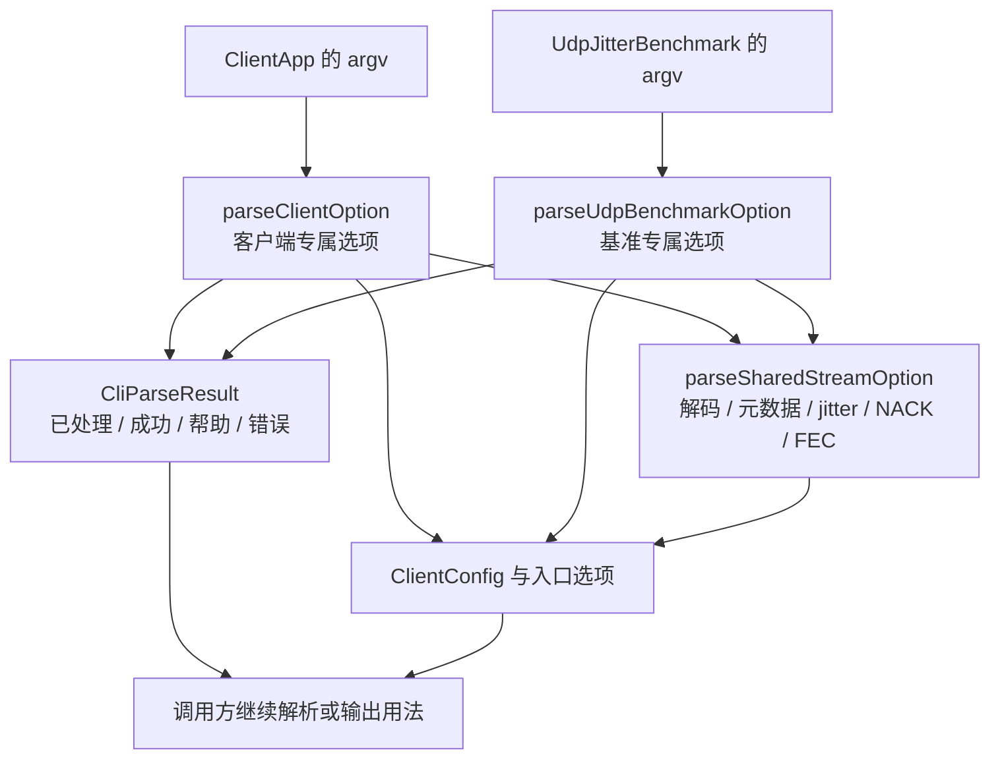

它做的事把命令行参数映射进统一的客户端配置结构：控制地址端口、设备、画质、网络策略、加密请求、软硬解码后端、vsync 和队列容量等等。那个配置结构同时是传输模块的运行参数集合——UDP 的各种容量上限、抖动缓冲策略、重传和纠错参数全都在里面，一份结构从命令行一路传到收包循环。基准工具专用的参数（媒体测试端点、测量多少帧、是否解码）单独一组解析函数。程序无参数启动时走图形连接面板，带参数启动时直接连——这个判定在入口模块做，跟本模块无关。

### playback：播放编排中枢

playback 负责客户端的播放编排：它建两条工作线程，把传输、解码、渲染串成一条线，并把播放相关的所有策略集中成几个纯函数文件——这几个文件全部有独立单测，是理解客户端播放行为最快的入口。数据流和线程的全图：

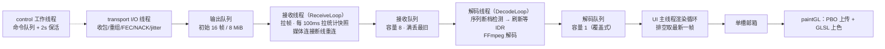

两条线程分工明确。**接收线程**从传输门面拉完整帧，塞进容量 8 的接收队列；每 100 毫秒顺手拉一次 UDP 统计快照供汇总——统计这种会随需求膨胀的活不放进收包循环，是 I/O 线程和接收线程的分工线；媒体连接断开时还负责重建连接，最多 10 次、每次隔 1 秒。**解码线程**检查帧序列是否连续——**序列断档检测**：帧元数据里有序列号，本帧的序列号不是上一帧加一，就说明中间丢帧了、参考链已断。此时置重同步标志，把后续的普通帧全丢掉，调用解码器的刷新方法清空参考帧，等下一个关键帧从头建链；等关键帧期间，按冷却策略通过控制通道请求服务端补关键帧——RTT 未知时冷却 1.5 秒，已知时按 2×RTT+200ms 夹在 300～1500ms，当前帧如果自己就带关键帧则取消请求。这里选择暂时停帧来避免花屏：花屏是参考链断了还硬解，画面看着有其实全是坏的，用户可能把花屏理解为系统故障；停帧是主动丢弃解不了的部分、保留上一幅有效画面，短暂、可恢复，用户看到的是类似网络短暂卡顿的停帧。正常帧过解码器，产出进**容量为 1 的解码队列**——中间的帧直接覆盖，这样可以限制客户端的显示延迟。

**主线程跑渲染循环**：以很小的超时（4 毫秒）等解码帧，醒来后把队列排空、只留最新一帧去渲染——"等一小会、再排空取最新"的组合，既不空转也不排旧帧。空格暂停、退出键退出，按键经界面模块的待决队列进来。期间消费界面来的模式切换请求：先规范化、判断是否真的需要重连（比如请求和当前完全一致就不折腾），需要则通知上层重连。**统计是双频率的**：有图像提交进展时按至少 5 秒间隔输出一条性能摘要日志，六段延迟的分位数都有——从采集到渲染的端到端、网络到接收、接收到解码、解码本身、解码到渲染、接收到渲染——5 秒是因为分位数要有样本量，30 帧率下 100 多个样本统计结果才比较稳定，一两秒的窗口 p95 抖得没参考价值；界面统计面板 100 毫秒刷一次——一个是给分析用的，一个是给眼睛用的，两个频率分开定。跨机的段依赖开头讲的时钟偏移估计器对齐。**停顿监控**：渲染无进展 2 秒先记警告，日志里带阶段定位——是没收到帧、还是收到帧在等关键帧、还是解码正常渲染卡住，三种情况的处理方向完全不同；管理模式下 3 秒还没起色就发信号触发上层的自动恢复。

三个策略文件分别处理不同的判断，全部是"输入参数、输出决策"的纯函数。**关键帧恢复策略**：管要帧的冷却与取消——多久之内不重复要、什么情况下的请求可以撤销。**模式切换策略**：判定用户的切换请求是否真的需要重连，当前只比较控制端点、传输、网络策略和画质，不把服务端活动媒体档位当作用户请求变化。**断流恢复策略**做三选一决策：参数没变就"重挂运行中的管线"（重新 START 并采用返回的实际媒体参数，加密会话会更新密钥和传输）；服务端空闲就"新建管线"；参数彻底对不上才"转人工"，自动画质允许活动档位变化。决策的输入是状态查询的结果和本会话的参数，纯比较逻辑，所以能完整单测——这样可以将判断逻辑与执行流程分开，并独立测试。

### app：入口和顶层流程

入口模块的 main 只有一行，调 runClientApp，后者是客户端全流程的编排，也是唯一一个把所有模块都拿在手里的地方。启动先处理 macOS 的一个渲染后端兼容问题——Qt 新版本默认走另一条渲染路径，跟自管理的 OpenGL 上下文冲突，显式关掉；然后在 QApplication 构造之前设置全局默认 OpenGL 3.3 核心 profile，创建 Qt 应用对象，再初始化渲染器拿到可绘制控件、初始化界面。接着分叉：无参数启动显示连接面板等用户填地址，带参数直接按参数连——注意带参数启动的仍然是带界面的完整程序，没有无界面的纯命令模式。两种方式最终汇进同一条托管流程。

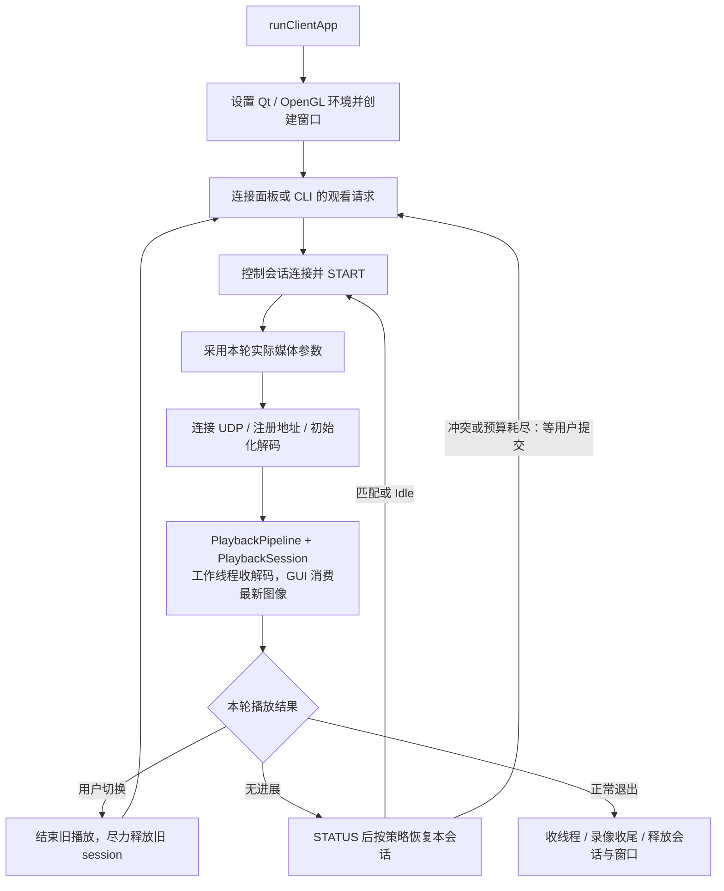

**托管流程**对应服务端那套控制协议：控制会话异步连接服务端；用显式 session 发 START，媒体档位由服务端配置决定；拿响应里的实际端口和 codec 连接 UDP 媒体并初始化解码，接收端再用完整报告注册地址。连接媒体带 20 次重试、每次间隔 100 毫秒——这不是多余的谨慎，是吸收容器环境里"响应说端口绑好了、实际网络命名空间还没就绪"的窗口期。阻塞的连接重试用临时线程跑，主线程边等边用事件泵处理界面事件，窗口保持响应、还能随时取消。

入口模块负责**断流自动恢复**，由播放层的停顿信号触发。第一步不是盲目重连，**是先发状态查询问服务端现在什么情况**——直接采用"断线就重启"会影响多客户端场景：其他会话仍在共享采集与编码，恢复只处理自己的会话。拿到状态后交给断流恢复策略做三选一决策（前面讲过的重挂、新建、转人工），再按决策执行。单轮最多试 3 次、每次隔 1 秒；还有个更深的熔合判断——连续 3 轮"恢复流程走完了但依然没有渲染出画面"，说明恢复在空转，转人工，不再无限循环。弱网档位到客户端参数的映射也在这里：自动模式和固定三档各自对应一套抖动缓冲、重传、纠错的参数组合，启动时按服务端确认的生效档装配进传输模块。

主线程同时执行两类工作：它既是 Qt 的界面线程，又是渲染循环线程——渲染和界面运行在同一条线程上，绘制事件由这条线程的消费循环驱动，不需要任何跨线程的图形上下文处理，这也避免了工作线程直接操作图形上下文。模式切换的日志也归这个模块统一记，切换请求从哪来、规范化成了什么、最终连没连，一条链路能追全。

---

## 双端串联说明

### 一帧的端到端过程

把两个程序连起来，一帧画面从摄像头感光到屏幕发光的完整路径：

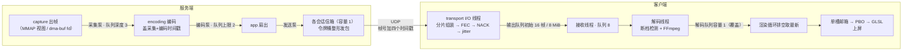

一帧图像依次经过以下处理。**服务端这边**：采集模块从驱动拿到一帧原始画面——CPU 路径可复制或引用映射，硬件路径可以是一个 DMA-BUF 描述符，帧对象身上挂着析构归还的钩子，最后一个持有者释放时归还缓冲；共享采集泵把引用投到各子流第一个队列，深度 3，满了丢最旧。编码泵取出来，软编先转格式再压成 H\.264，硬编经二维加速器转 NV12 后编码 H.264/H.265，出来的码流带着序列号和一路时间戳进第二个队列，上限 2。发送泵取出帧，通过扇出回调把它塞进订阅对应传输实例的发送信箱——容量 1，慢的会话只会在自己这儿丢帧；发送线程按令牌桶的额度把帧发上网络，帧头里带着帧号和四个时间戳。**客户端这边**：输入输出线程收到包，UDP 模式下先按位图组装分片，缺片先用逐组异或纠错补，补不了按预算节奏发重传请求等对端补发，凑齐的完整帧在抖动缓冲里等到期出帧；完整帧经过有界队列交付。接收线程拉到帧，进容量 8 的接收队列。解码线程检查序列号，没断档就喂给 FFmpeg，解码出的画面进容量 1 的解码队列——中间的帧被覆盖，只留最新。主线程的渲染循环取走最新帧，发布进单槽邮箱，绘制事件里从邮箱取出来，经 PBO 双缓冲上传纹理或从 macOS IOSurface 导入图像，着色器完成颜色转换，画面上屏；统计面板每 100 毫秒刷新一次这趟旅程的分段耗时。

一路数下去：服务端三级队列 3、2、1，客户端 8、1、单槽邮箱——**越靠近两端的出口越浅，全链路要最新不要排队**，延迟不随网络抖动累积，这些队列限制共同控制链路中的帧积压。按项目里的分段统计，端到端延迟的大头是摄像头曝光和编码器，打包、传输、接收这些代码只占几毫秒——所以优化方向是手动曝光和硬件编码，而不是继续压缩收发代码的耗时。

### 线程全景

两个程序的线程合在一起看：

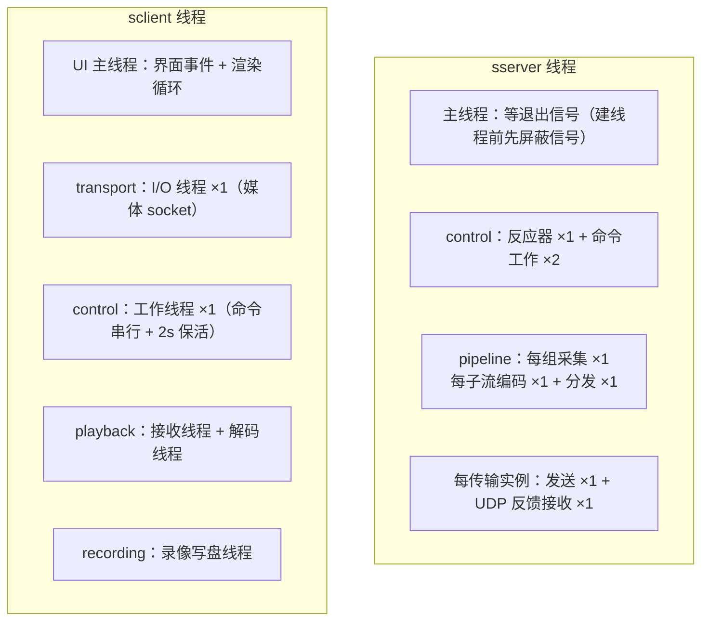

服务端的线程数量取决于启用的功能和实际运行的资源实例。这里统计项目代码管理的线程，**包含主线程，不包含编解码库内部线程**。

| 线程 | 数量 | 创建条件和职责 |
|---|---|---|
| 主线程 | 1 | 程序入口，等待退出或 SIGHUP 重载信号 |
| 控制 I/O 线程 | 1 | 运行 EpollReactor，处理控制连接的读写事件 |
| 控制命令 worker | 默认 2 | 执行 START、STOP、STATUS 等命令，数量由 control.workers 决定 |
| 采集线程 | 每个活跃采集组 1 条 | 从该设备取得原始帧，交给本组编码子流 |
| 编码线程 | 每个活跃编码子流 1 条 | 对本子流的输入帧进行编码 |
| 子流分发线程 | 每个活跃编码子流 1 条 | 取出编码帧，经 app 投递到对应传输信箱，不在这里等待网络发送 |
| UDP 发送线程 | 每个传输实例 1 条 | 消费发送信箱，执行分片、FEC、pacing 和发送 |
| UDP 反馈接收线程 | 每个传输实例 1 条 | 接收质量报告，处理 NACK 和重传 |
| 自动画质切档线程 | 0 或 1 | 第一次需要自动切换主子流时创建；之后保留，即使当前没有切档也计入 |
| systemd 看门狗线程 | 0 或 1 | WATCHDOG_USEC 为正时创建，周期发送心跳 |

**默认 2 个命令 worker 时，固定部分是 4 条：主线程 1＋控制 I/O 1＋命令 worker 2。** 在此基础上，按实际资源继续相加：

`总数 = 4 + 采集组数 + 2 × 活跃编码子流数 + 2 × 传输实例数 + 自动画质切档线程数 + 看门狗线程数`

例如，不启用看门狗时：

| 运行场景 | 计算 | 合计 |
|---|---|---:|
| 刚启动、尚未观看，也未创建画质切档线程 | 固定部分 4 | 4 条 |
| 单摄像头、1 路编码子流、1 个传输实例，未创建画质切档线程 | 4＋采集 1＋编码/分发 2＋UDP 收发 2 | 9 条 |
| 上述观看场景，自动画质切档线程已经创建，当前只保留1路编码子流 | 9＋画质切档 1 | 10 条 |
| 同一自动会话切档期间，新旧两路编码子流暂时并存，传输实例仍为1个 | 10＋目标子流编码/分发 2 | 临时 12 条 |

启用看门狗后，上述数量再加 1。每多一个实际运行的采集组加 1，每多一路编码子流加 2，每多一个传输实例加 2；**按资源实例计数，不按观看人数直接相乘**，因为多个会话可能共享采集、编码或符合条件的明文传输。自动网络策略在已有 UDP 反馈线程中更新，不会另起一条线程；FdEventWaiter 也在采集线程中等待，不额外创建线程。

客户端播放主链路主要是五条线程：UI 主线程兼任渲染循环；输入输出线程包揽媒体 socket 和收包处理；控制工作线程串行执行命令并做 2 秒一次的保活；接收和解码两条线程由播放层管理。录像时另有写盘线程，连接期间还可能有临时线程。

**线程之间的交接只有三种形态**：满时丢最旧的有界队列、覆盖式的单槽邮箱、取走即清的原子标志。没有跨线程裸共享可变状态，队列、连接表和资源状态由各自的锁或原子变量保护。关闭时需要按顺序停止各部分：服务端先收子流编码和分发线程，再收采集线程，发送线程必须先于传输层拆除，因为它持有传输的引用；每个文件描述符有唯一的属主和唯一的关闭路径，先从事件循环注销、再关闭，用原子标记保证只执行一次。按上述顺序处理，可以在正常关闭和异常退出时回收线程、文件描述符和缓冲资源。

### 总结

服务端：base 管帧长什么样和线程怎么交接，通过析构回调归还零拷贝缓冲；logger 用结构化日志让一次故障能按会话串成时间线；reactor 管控制事件与采集设备等待，文件描述符在关闭前先从事件循环注销；appconfig 把唯一一份配置严格地装进来，档位继承让设备与画质分家；contracts 用一个接口把协议和实现切开，几十行看完控制面全貌；capture 从摄像头拿画面，CPU 路径可复制或引用映射，硬路可走 DMA-BUF 反向分配，帧析构自动还缓冲；encoding 双后端编码，软编通用、硬编省 CPU，GOP 固定 30 帧加超帧限幅，绝不丢编码帧控码率；transport UDP 推流，靠容量 1 的信箱隔离慢客户端、靠令牌桶控制关键帧突发发送；pipeline 按采集组与编码子流组织，三级队列 3、2、1 逐级收窄，丢编码帧必触发补关键帧；control 只解析协议不执行业务，一个反应器带一个小线程池，忙连接摘事件借内核缓冲背压；app 是唯一同时看见管线和会话表的地方，自动换档切本会话订阅，不重启其他会话采集，租约替崩溃的客户端收尾。
客户端：base 管解码帧和交接工具，单槽邮箱只保留最新值；logger 跟服务端对齐，两边日志能拼成一条时间线；transport 收流加四层弱网恢复，媒体 socket 收敛在一条 I/O 线程，恢复等待受预算约束；control 把文本命令变成可等待的结果还管保活和显式会话释放；decoding 是 FFmpeg 软硬解码的薄封装，刷新方法用于断档重同步，诊断字段稳定可 grep；rendering 用 PBO 或 IOSurface 和着色器避免 CPU 转 RGB，GPU 对象常驻只更新内容；ui 靠待决请求队列避开跨线程控件，统计面板 100 毫秒一刷；cli 是共享的参数解析库而不是播放器，一份配置结构从命令行贯通到收包循环；playback 负责播放编排，断档检测、停帧优于花屏、三个纯函数策略文件都在这；app 把全流程串起来，断流时先问服务端再决定怎么恢复，恢复空转三轮就转人工。
