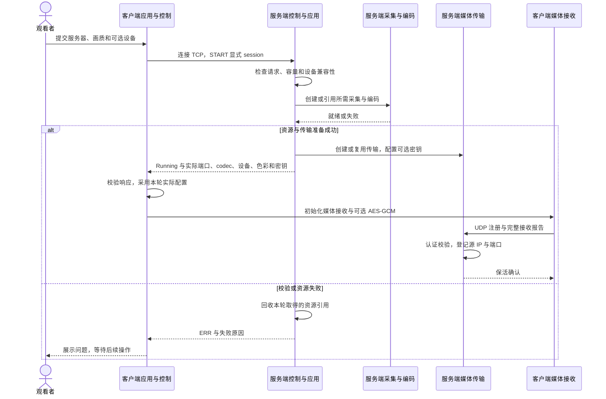
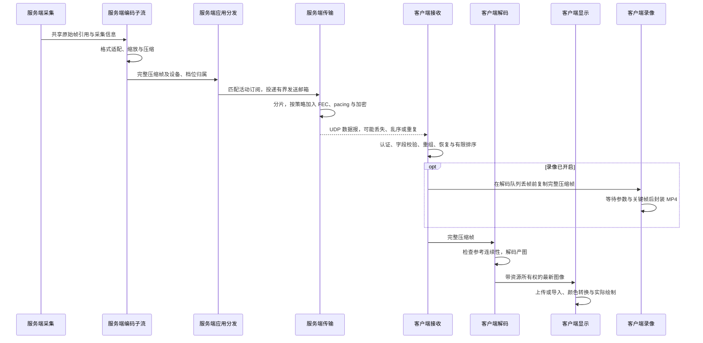
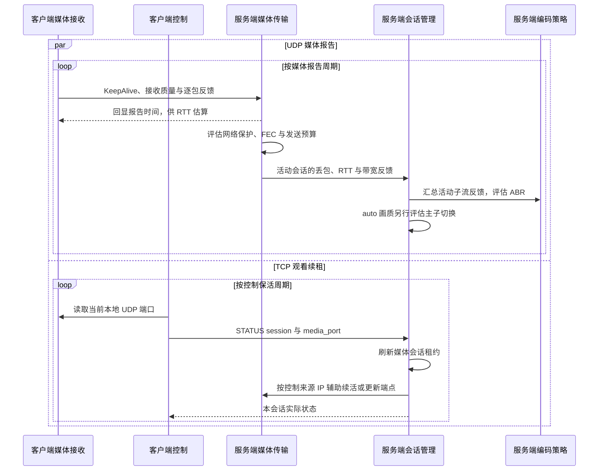
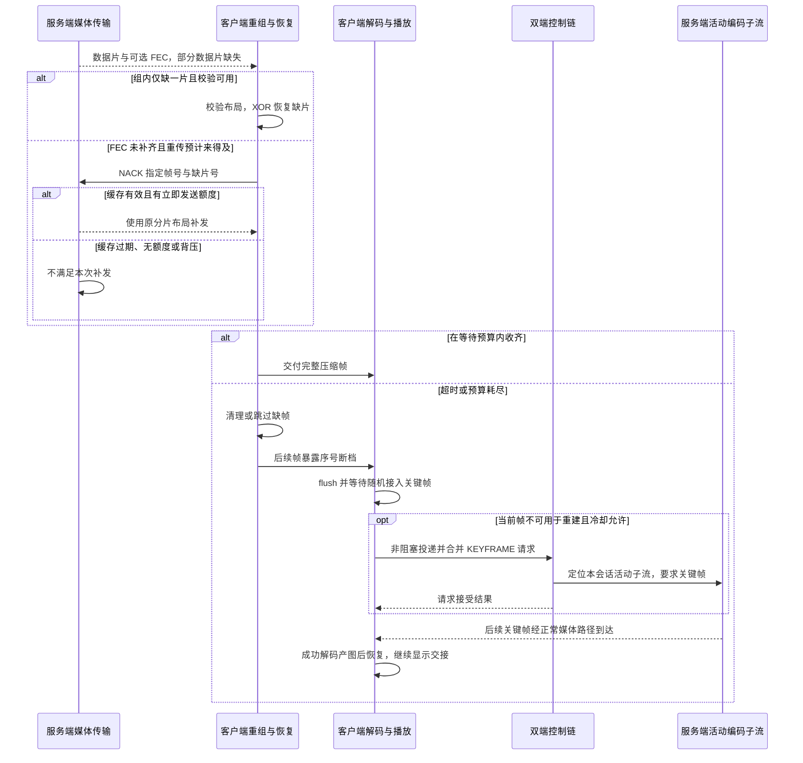
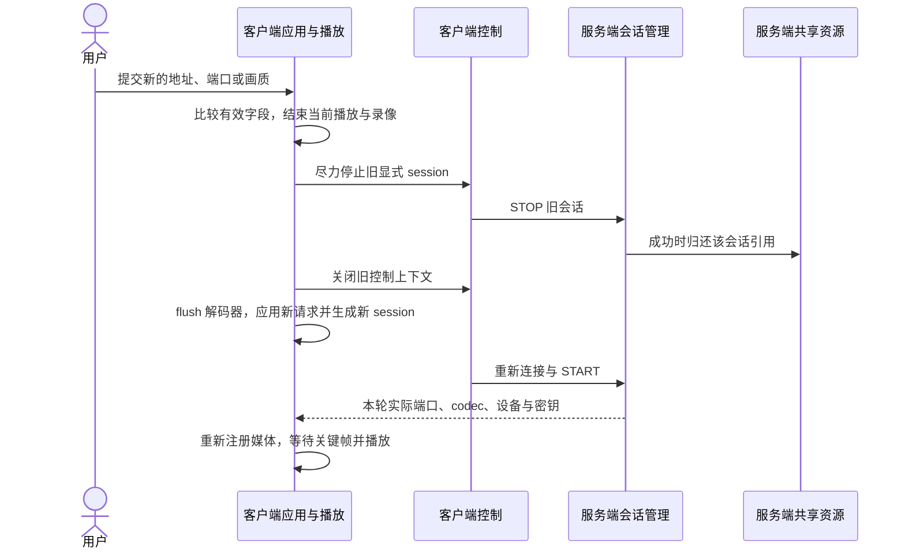
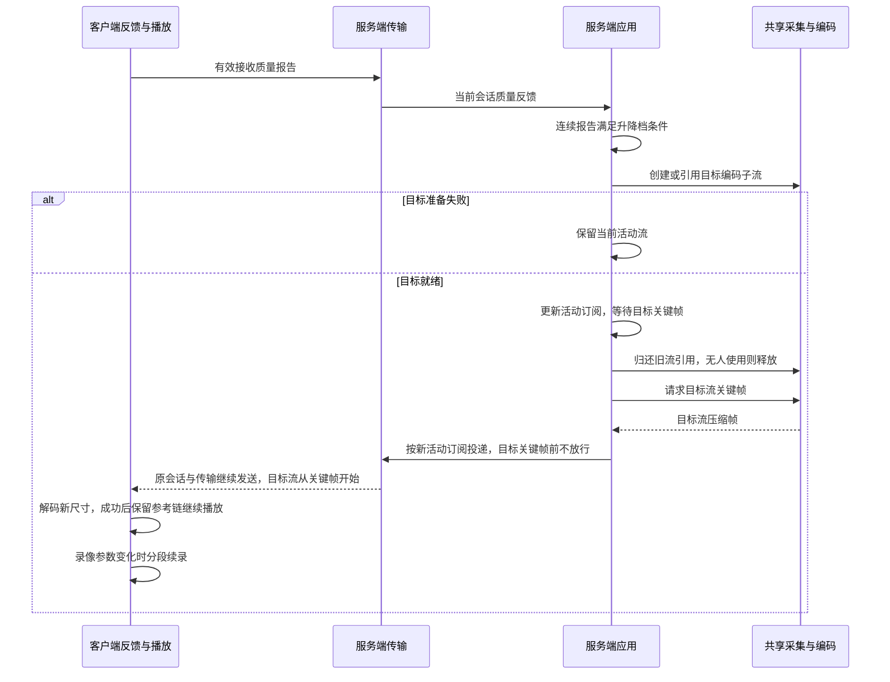
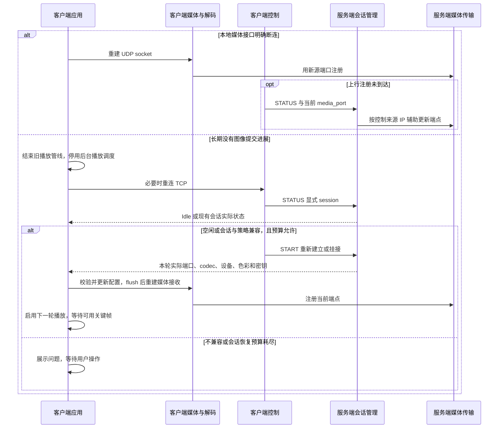
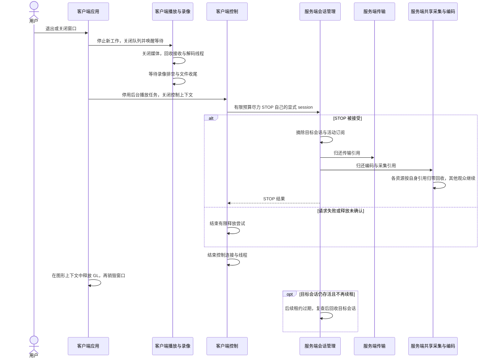

# 实时视频系统：客户端与服务端如何完成一次观看

本文沿双端交接说明一次观看如何建立、传输、恢复、切换与退出。模块职责见 [服务端概览](服务端模块说明.md) 和 [客户端概览](../../sclient/docs/客户端模块说明.md)，具体协议和参数按文末入口查阅。

时序图表达主要因果关系，参与者代表职责边界，不一一对应线程；图中未展开的并发、排队与超时仍可能影响实际耗时。

## 阅读导航

| 关键流程 | 内容 |
|---|---|
| [通信约定](#1-双端通信约定) | 控制、媒体、反馈及端口分工 |
| [连接与注册](#2-建立观看并注册接收地址) | START、实际配置、密钥和 UDP 端点 |
| [一帧视频](#3-一帧视频从摄像头到屏幕) | 采集、编码、发送、重组、解码与绘制 |
| [持续反馈](#4-持续反馈与会话续租) | UDP 报告、TCP STATUS 与策略调整 |
| [丢包恢复](#5-从补片到关键帧恢复) | FEC、NACK、参考链恢复的先后条件 |
| [画质切换](#6-手动切换与自动切档) | 重新建立观看与原会话换流的区别 |
| [断流恢复](#7-断流换端口与服务端重启) | 媒体重连、会话核对和重新 START |
| [本地操作](#8-暂停截图与录像) | 哪些操作需要另一端配合 |
| [退出回收](#9-退出与共享资源回收) | 显式 STOP、引用归还和租约兜底 |

## 1. 双端通信约定

| 通道 | 方向与用途 |
|---|---|
| TCP 控制 | 客户端发 START、STATUS、STOP、KEYFRAME，服务端返回实际状态 |
| UDP 下行 | 服务端发视频数据片、FEC 校验、重传与保活确认 |
| UDP 上行 | 客户端发注册、接收质量报告和 NACK |

控制端口用于连接管理服务；START 返回的媒体端口是服务端 UDP 端口；客户端本地 UDP 源端口才是其接收位置的一部分。服务端由上行报文源地址学习端点，也可通过 STATUS 的 media_port 辅助更新。

正式客户端 START 请求显式 session，使用 port=0 分配服务端媒体端口。设备留空沿用服务端策略；`quality` 表达画质，`profile` 表达网络策略，服务端配置决定 `media_profile`。

TCP 连接、观看会话、UDP 端点、采集组和编码子流各有生命周期。控制断开不等于媒体立即停止，一个观众退出也不等于关闭所有共享资源。

## 2. 建立观看并注册接收地址

START 成功表示观看关系建立；UDP 注册使服务端知道视频应发往哪里；真正显示还需下一节的完整媒体链路。注册前的编码帧不会为该观众无限积压。

加密 START 每次建立新密钥与传输上下文，客户端先初始化加密再发送上行注册；响应密钥非法或与请求不一致时连接失败。同参数明文 START 可幂等复用，不能据此推断所有重复 START 都保留原端口和密钥。

密钥通过控制响应交付，媒体认证不等于控制通道加密或身份认证。加密外层和字段布局见 [两端媒体加密模块](#10-深入阅读)。

## 3. 一帧视频从摄像头到屏幕

兼容的同设备观众共享采集，同档位共享编码；应用按订阅选择发送目标。加密、自动画质或自动网络策略会话独享传输，符合条件的固定画质明文会话可共享传输。

各阶段通过有界队列交接。发送跟不上时不无限堆积旧视频，客户端显示也只消费最新图像；压缩帧被丢弃时可能需要恢复参考链。

服务端发送、客户端完整帧、解码产图、渲染提交和实际绘制是不同成功点。跨主机时间也不能直接裸相减，端到端估算的测量边界见两端概览。

## 4. 持续反馈与会话续租

| 决策 | 作用范围 |
|---|---|
| 网络 profile | 分片和发送保护，自动模式在帧边界生效 |
| ABR | 共享编码子流的目标码率与降级意图，联动 pacing |
| 自动画质 | 某个会话当前选择主流还是子流 |
| 客户端本地缓冲 | 本机有限排序、等待和跳帧 |

这些决策相互配合但各有条件。关闭 ABR 不关闭自动画质；profile=auto 与本地缓冲 strategy=auto 也不是同一个选项。

UDP 报告不能替代 START/STATUS 对媒体会话的续租，STATUS 也不能替代包级质量反馈。码率目标与实际编码输出还要分别观察，后端限制见 [编码说明](../modules/encoding/README.md)。

## 5. 从补片到关键帧恢复

- FEC 每组一份 XOR 只能修复该组一个缺口，需要校验和其余数据齐全、布局一致。
- NACK 受乱序等待、RTT、期限、次数、令牌和熔断限制；服务器还要检查缓存与发送额度。
- 补片修复帧内容，关键帧修复解码参考。若断档后的当前帧已可重建参考，就不必再请求。
- KEYFRAME 成功响应仅表示接受请求；关键帧自身仍可能丢失，恢复要看实际产图和显示进展。

服务端发送队列丢弃压缩帧时，也可在本地触发关键帧恢复信号。同一编码子流的其他观众可能收到该关键帧，不能把共享编码理解为完全隔离。

## 6. 手动切换与自动切档

### 6.1 用户提交新的观看请求

有效切换比较主机、端口、传输、profile 和 quality，相同请求忽略。当前 device 未参与比较，仅修改设备不保证触发在线重连。

旧 STOP 未确认时，下一轮仍使用新 session，不依赖同名替换；旧资源可能暂存，由租约兜底回收。不会用无 session 的全局 STOP 清理。

### 6.2 auto 在原会话内切换主子流

自动画质初始只持有主流，稳定档位下只保留当前一路；没有配对子流时按实际能力回落。无需客户端主动重连，但目标初始化、排队和关键帧到达仍可能产生等待。

自动网络 profile 切换是另一种调整：它改变分片与保护，在帧边界生效，不重建 socket、密钥或编码器。切换门槛见 [网络配置](../config/README.md#udp-丢包恢复差异)。

## 7. 断流、换端口与服务端重启

- TCP 短时断开时，租约与端点仍有效可继续收 UDP；STATUS 续租不等于取得 STOP/KEYFRAME 归属，成功 START 才可转移连接归属。
- STATUS 辅助更新端点时，无同源条目可补登记，单条目可改写，同 IP 多端点有歧义时只续活，不抢改端口。
- 同密钥仅重挂媒体连接时保留上行计数器；新的加密 START 则采用新材料，不能复用旧密钥与端口假设。

当前会话恢复分支在播放调度停用期间立即调用 KEYFRAME，该请求被拒绝，下一轮不会补发；仍需等待可用关键帧或后续恢复触发。

媒体、控制和会话恢复各有预算。会话恢复失败可回面板，本地接收管线重连全失败若先返回错误，正式客户端也可能退出；不承诺固定恢复总耗时。

服务端重启后，内存中的会话、设备引用、编码器、端点、密钥和重传缓存都需重建。客户端可保留观看意图，必须重新查询、START 并采用实际响应，无法补回旧缓存已丢失的历史帧。

## 8. 暂停、截图与录像

| 操作 | 客户端行为 | 对服务端的影响 |
|---|---|---|
| 暂停显示 | 后台接收、解码和已开启录像继续；恢复后显示最新图像 | 不发 STOP，反馈与续租继续 |
| 截图 | 保存视频控件 framebuffer，含缩放与留边 | 无额外媒体请求 |
| 开始录像 | 压缩帧进入独立队列，等参数与关键帧后创建 MP4 | 允许时请求活动子流关键帧 |
| 录像参数变化 | 结束旧文件，等待新参数与关键帧后续录 | 正常提供新流，服务端不操作本地文件 |
| 停止录像 | 关闭新帧入口，排空队列并写文件尾 | 不停止观看会话 |

暂停时截图请求会延后到恢复后消费，不能保证立即保存暂停画面。录像保存原压缩视频、不含音频，与显示截图的尺寸和帧集合可能不同。

录像队列或写盘失败通常只结束录像，播放继续；手动观看切换会结束当前录像。录像写入计数不代表文件已收尾，强制退出也不能保证最后片段完整。

## 9. 退出与共享资源回收

客户端发送 START 时就记录待释放 session，即使成功响应丢失，仍有明确的尽力 STOP 目标。清理失败不扩大成全局停止，本地退出不等待远端租约回收。

| 失效对象 | 到期后的主要动作 |
|---|---|
| TCP 控制连接 | 关闭连接、释放连接归属 |
| UDP 接收端点 | 移除失活接收地址 |
| 媒体会话租约 | 摘除观看关系并归还资源引用 |

三种有效期独立。租约候选在真正摘除前还会复查，避免回收刚被续租的观看；共享子流或采集组只在最后一个使用者离开后关闭。

## 10. 深入阅读

- [服务端模块说明](服务端模块说明.md)、[客户端模块说明](../../sclient/docs/客户端模块说明.md)：单端架构与能力边界。
- [服务端控制](../modules/control/README.md)、[客户端控制](../../sclient/modules/control/README.md)：命令、会话与释放语义。
- [服务端传输](../modules/transport/README.md)、[客户端传输](../../sclient/modules/transport/README.md)：分片、FEC、NACK、缓冲和反馈。
- [服务端媒体加密](../modules/mediasec/README.md)、[客户端媒体加密](../../sclient/modules/mediasec/README.md)：密钥、认证与计数器约束。
- [客户端播放](../../sclient/modules/playback/README.md)、[录像](../../sclient/modules/recording/README.md)：参考恢复、本地操作与文件收尾。
- [服务端配置](../config/README.md)：媒体档位、策略门槛、租约与运行参数。
