# 低延时视频图传系统：服务端模块说明

## 系统全貌

这是一套面向嵌入式设备远程监控的低延时视频图传系统，用 C\+\+17 写的，分服务端和客户端两个程序。**服务端叫 sserver**，常驻运行在 RK3576 开发板或任意 Linux 机器上，职责是把摄像头画面采出来、编成 H.264 或 H.265、推到网络上；在 RK 板子上它能走 DMA\-BUF、RGA、MPP 组成的全硬件零拷贝链路，CPU 几乎不参与像素搬运，在普通 Linux 上退化为 x264 软件编码。**客户端叫 sclient**，是 Qt6 写的跨平台程序，Linux、Windows、macOS 都能跑，职责是连上服务端、协商好参数、收流、用 FFmpeg 解码、用 OpenGL 渲染。两个程序各自是一个独立 CMake 工程，并排放在 media 目录下，模块结构、日志格式、二进制线格式保持对应，联调时两边能一一对应。

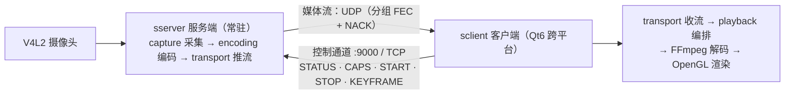

服务端是常驻的，媒体空闲时监听控制端口（默认 9000）等客户端来。客户端连上来先走一条自己设计的文本控制协议，命令一共五个：**STATUS** 查目标会话兼续租，**CAPS** 查服务端支持什么档位，**START** 选好传输方式和画质档位正式启动，**STOP** 停止，**KEYFRAME** 要一个关键帧。服务端收到 START 才把采集和编码的管线拉起来。多个客户端可以同时观看，同设备兼容请求共享采集，同档位共享编码，媒体只用 UDP；传输按加密、自动画质和网络策略决定独享或复用，有人退出归还自己的引用，相关资源无人使用才停止。控制连接上限 16 个，会话上限 8 个。

一次完整的取流交互是这样的：

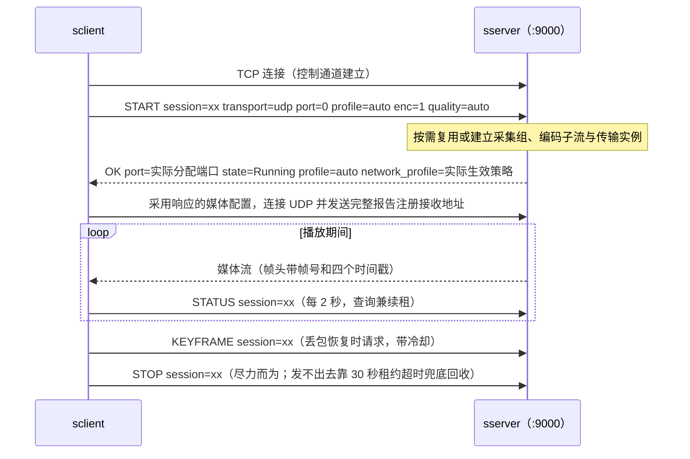

媒体传输当前只有 UDP，TCP 用于控制；UDP 要自己做分片和丢包恢复，这一部分包含分片、纠错和重传处理。画质档位叫 media\_profile，有六个主档位，各配一个子档位，本质是"采集格式乘编码后端"的组合：最低配的 yuyv\_x264 是 640×480、25 帧、800 kbps 的软编档，任何 Linux 都能跑；mjpeg\_x264 优先请求 1080p、30 帧 MJPEG，也可回退尺寸或 YUYV，再经对应预处理由 x264 编码，2\.5 Mbps 码率，是软件链路里的高清对照档；yuyv\_mpp 和 mjpeg\_mpp 两档在 RK 板子上分别用 700 kbps 和 2\.5 Mbps 的硬件编码，首个档位采用硬件采集路径时可走 DMA-BUF。另有 yuyv_h265、mjpeg_h265 两个 MPP H.265 主档位。采集编码档位由服务端配置决定，客户端用 quality 选择主流、子流或自动画质。UDP 下有自动网络策略和三档固定弱网策略：balanced 用 1200 字节的大分片加重传；adaptive 用 1000 字节分片，加重传加分组前向纠错；resilient 用 256 字节的小分片加全套恢复，给最差网络用。客户端默认请求 profile=auto，固定策略仍可由命令行选择；服务端回显请求 profile，自动模式另以 network_profile 回显实际策略，客户端按确认的请求模式装配本地接收策略。

整套系统按低延迟优先设计，需要限制旧帧积压：**实时观看优先显示最新帧，旧帧排队会增加延迟**。所以从服务端到客户端，各环节使用较小容量的队列，满了就丢最旧的帧；弱网下宁可降画质、丢帧、黑屏一下，也不让延迟涨上去。后面会分别介绍各模块的队列和丢帧处理方式。

下面依次介绍服务端 12 个模块，最后说明双端如何配合。

## 服务端 sserver 的 12 个模块

服务端 12 个模块的依赖关系是严格单向、自底向上的，这张图就是读服务端代码的地图——下层不知道上层存在，上层只通过头文件接口用下层：

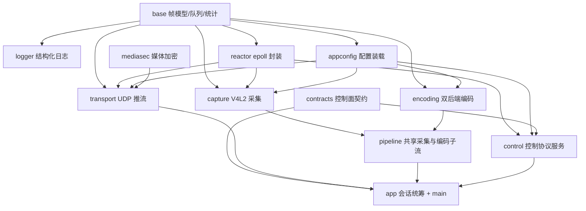

### base：帧模型和线程交接工具

base 是全仓库最底层的公共库，回答两个最基础的问题：一帧数据长什么样，线程之间怎么把帧交来交去。它不含任何业务逻辑，被上层模块共同使用。

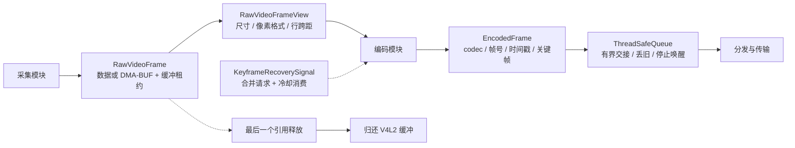

帧分两种。**原始帧**对应采集出来的画面，可能是 YUYV 也可能是 MJPEG，由三部分组成：一个零拷贝视图类型，除了数据指针和宽高，额外携带 DMA\-BUF 的文件描述符和行跨距——MMAP 映射出来的画面每一行的跨度可能比"宽度乘每像素字节数"还大，也就是行尾有填充字节，下游消费者必须感知这个跨距，否则按紧凑排列去读画面就是歪的；一个完整帧类型，既可以持有数据的拷贝，也可以只挂一个对 V4L2 缓冲的"租约"，走租约模式时帧对象身上带一个归还回调，**帧对象析构的那一刻自动把缓冲还回驱动**——这样可以在零拷贝路径中及时归还缓冲，一帧会流经多条线程、多个队列，由最后一个持有者释放时触发析构归还，不需要谁来记得还；还有一个像素格式枚举，包含 Unknown、YUYV 和 MJPEG。**编码帧**是另一种模型，身上带序列号（编码实例内递增，自动会话传输会接续映射）、codec、采集时间戳、编码开始和结束时间戳、关键帧标志和编码后的字节载荷——这些时间戳会一路跟着帧进网络，客户端的分段延迟统计全靠它们。

线程交接使用以下工具。**线程安全队列**支持满时丢最旧，用于通过丢弃旧帧限制链路延迟；它的等待接口用谓词模板实现——操作系统允许条件变量在没有被通知时醒来（虚假唤醒），所以等待必须写在循环里、醒来先检查条件、不满足接着睡，这个模式内建在队列实现里，用的人直接给谓词；停止时通知全部等待者，大家醒来发现运行标志清了就退出，线程不会在关闭时卡死在队列上。**丢帧恢复信号**是个原子变量：任何环节丢了已编码的帧就通过它请求编码器补一个关键帧，请求用原子交换操作"取走即清"，内置 500 毫秒冷却——多个会话同时请求也只生效一次，防止连续 IDR 导致码率突增。**延迟记录器**负责采样和分位数统计，最小值、平均值、p50、p95、p99、最大值都有，编码有进展时按至少 5 秒间隔输出的性能摘要就是它算的；配套的日志工具函数能把统计结果直接拼进结构化日志的字段里。**帧诊断器**每 120 帧抽一个样本，对载荷做指纹并扫描 NAL 类型，用于"到底发出去的是不是合法码流"这类低频核查。还有**单调时钟**工具和**组件生命周期状态**枚举：前者全链路时间戳统一用它，跟墙钟无关、不受系统改时间影响；后者给各组件标"未初始化/运行中/已停止"这类状态，关停顺序的断言用它。UDP 的线格式常量定义在 transport 的协议头中，服务端和客户端两份定义必须一字不差。

### logger：结构化日志

logger 是 spdlog 的封装，输出 logfmt 风格的键值对日志：每条日志由组件名、事件名、会话号加若干键值字段组成，字段值做转义处理保证能被脚本安全解析。输出双通道：控制台加轮转文件，单文件 10MB、保留 5 个，文件名用进程的起止时间命名——运行中文件名带 running 后缀，正常退出后改名为带起止两段时间的定稿名，可以根据文件名确定日志对应的运行时段。

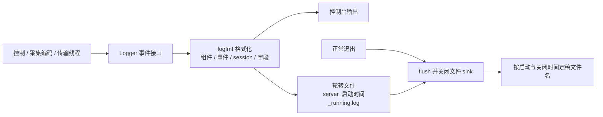

排障时可以按以下字段关联日志。按 session id 关联控制和传输，共享管线的日志再按设备和档位关联，控制通道、管线、传输三个地方的日志就能串成一条完整时间线，便于查看卡顿前后的事件及其先后关系。服务端有编码进展时按至少 5 秒间隔输出的性能摘要也是结构化行，真机上做编码耗时对比的脚本就是直接 grep 这一行拿数据统计的，要是记的自由文本，这事就得靠人眼。服务端和客户端使用一致的日志格式，联调时同一条链路两边的日志能对得上。接口上就是几个静态方法：按级别记事件、开关详尽模式、查当前日志文件路径、退出时冲刷定稿。同步落盘、自身不建线程。

### reactor：所有"等文件描述符"的地方

服务端控制事件和采集设备等待使用这个模块，它提供两种设施，共同点是都用 Linux 的 epoll、都不自建线程——循环由使用方的线程调用。

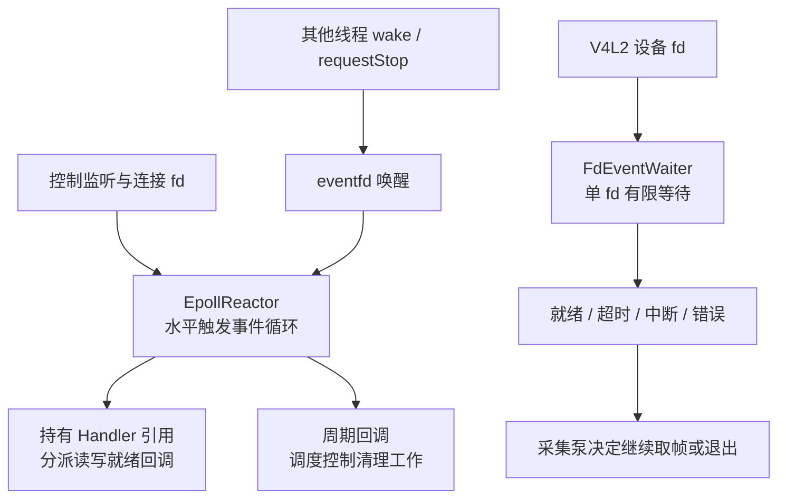

第一种叫 **EpollReactor**，是一个单线程的事件循环，水平触发模式。使用方注册文件描述符、关注的事件和回调对象，然后在自己的线程里跑它的阻塞循环，事件来了执行回调。事件循环按以下方式处理：回调对象用共享指针持有，保证回调执行期间对象一定活着，从机制上杜绝"事件还在队列里、对象已经析构"的 use\-after\-free——使用时要求：**必须先从反应器注销、再关闭文件描述符**，反过来的话注销动作可能操作已关闭或已被复用的描述符号，这是全仓库文件描述符生命周期的统一规则，保证每个描述符只有一个属主和一条关闭路径；支持用 eventfd 从别的线程唤醒循环，这是关停和跨线程通知的基础；每次等待最多取 128 个事件，防止一次突发使其他描述符长时间得不到处理；还支持让宿主在每次等待的间隙执行周期性任务——控制服务就用这个周期回调去扫描过期的会话租约，省一个专门的定时线程。控制服务拿一个实例管监听和全部控制连接；当前 UDP 媒体收发不使用原来的 TCP 媒体反应器。

**FdEventWaiter** 用于 V4L2 摄像头采集。`V4L2FrameSource::open()` 创建等待器，`captureRawFrame()` 调用 `waitReadable(200)` 等待设备可读，最长等待 200 毫秒；就绪后执行 `VIDIOC_DQBUF` 取帧。等待结果包括就绪、超时、中断和错误；设备尚未出帧时，采集线程阻塞在 epoll 上，避免空转轮询占用 CPU。

### appconfig：配置装载

服务端只有一份生产配置文件 control\.toml，这个模块负责装载和校验它。校验是严格风格：未知的关键字、类型写错、数值越界，一律拒绝启动，报错信息带文件在配置里的行号——配置错误必须在启动时报告，避免程序带着错误配置运行。命令行可以用参数覆盖受支持的基础配置字段，格式是"表名\.键名=值"，方便临时调参不改文件，覆盖发生在装载之后、生效之前。解析库用的是以单头文件形式直接入库的 toml\+\+，没有外部依赖，交叉编译时无需额外提供解析库。

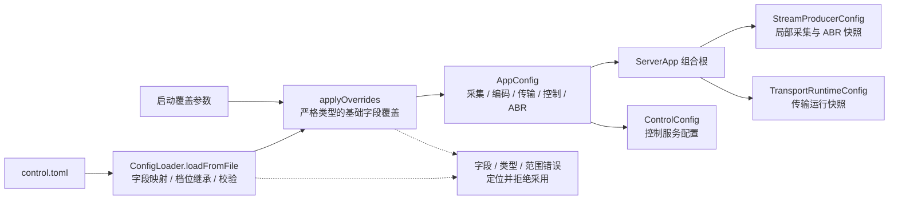

配置内容分采集、编码、传输、控制、运行时和 ABR 几块。采集块管设备路径、宽、高、帧率、像素格式、是否零拷贝、曝光参数，以及曝光的单位是 100 微秒。编码块选后端是 x264 还是 MPP，下面挂着两套后端各自的全部参数，码率、GOP、超帧限幅阈值都在这。传输块管绑定地址、监听端口，以及 UDP 的分片大小、重传、前向纠错、整形及媒体加密参数。控制块管控制端口、最大连接数、最大会话数、命令工作线程数、会话租约时长、可用档位白名单。运行时块管日志等设置，ABR 块管码率反馈参数。**档位定义有个继承设计**：每个档位是采集和编码两块配置的组合覆盖，档位里没写的字段自动继承全局基础表——所以换摄像头设备路径只改全局一处，所有档位自动跟着变。这里分别管理设备和格式：设备是主机的拓扑属性，跟着板子走；格式才是档位的属性，跟着画质需求走，两者分别配置。

### contracts：控制面的接口契约

这个模块是纯头文件接口库，只有一个定义文件，定义服务端控制面的接口与数据类型，建议读服务端代码时先看这里。

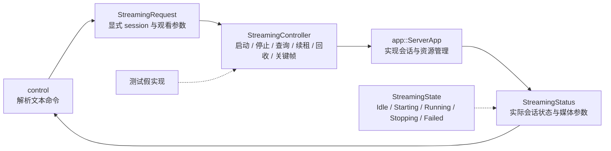

它定义了三样东西。一是一个**流状态机**：空闲、启动中、运行中、停止中、失败，五个状态加一个把状态转成可读名字的函数，服务端对外的状态汇报用它。二是**请求和状态的数据结构**：请求里带显式会话号、UDP、端口、网络策略、画质、设备、媒体档位和加密请求；状态里是当前生效的这些字段及实际 codec。三是一个叫 **StreamingController** 的抽象接口，方法六个：启动流、停止流、查状态、续租、回收过期会话、请求关键帧。

它存在的意义是把协议和实现切开：control 模块只负责把文本命令解析出来然后调这个接口，它不知道会话怎么管、管线怎么启；app 模块实现这个接口，它不关心命令是从 TCP 文本还是别的什么通道来的。两边可以独立替换和独立测试——测控制服务的时候注入一个假实现就能把协议层跑全，测会话逻辑的时候也不用真的起 socket。客户端不链接这个头文件，在自己的 control 模块中独立解析同一套文本协议，两端按相同的协议语义配合。

### mediasec：按会话保护 UDP 报文

mediasec 提供 AES-256-GCM 和会话密钥材料生成。客户端 START 带 `enc=1`，服务端能力允许后生成密钥与上下行盐；随机源失败则报错。密钥只在成功 START 响应中下发，STATUS、CAPS、KEYFRAME 和错误响应不披露它。

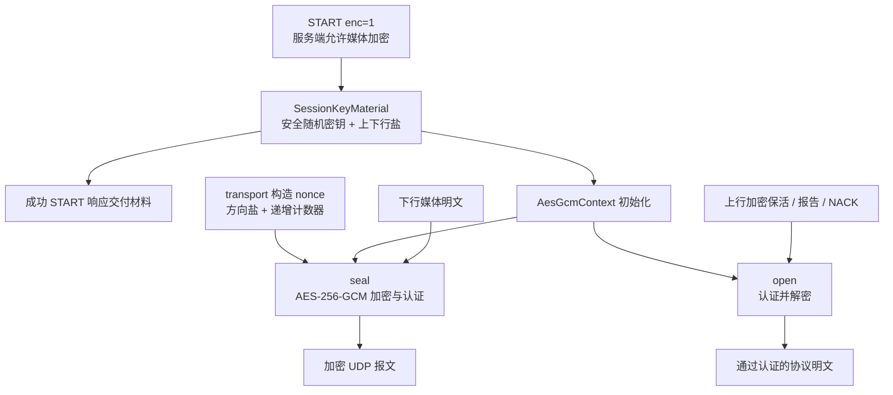

传输层负责逐报文认证加密，nonce 由方向盐和递增计数器组成。每次加密 START 创建新的密钥与传输上下文，采集与编码仍可共享。媒体加密保护 UDP 报文；控制连接仍是 TCP 文本，媒体加密不包含控制通道加密或身份认证。

### capture：从摄像头拿画面

capture 是链路第一环，把摄像头画面变成原始帧。对外一个接口（打开、启动、取帧、停止、关闭、自描述、查实际帧率），生产实现只有 V4L2 一种。标准流程走一遍：打开设备节点，查能力，协商格式和分辨率，申请一组缓冲，把缓冲入队还给驱动，开流；之后是个循环——出队拿一帧、用完再入队还回去，缓冲区轮着用；停止时关流。有个工具函数专门处理"系统调用被信号打断就重试"，还有一张缓冲表管理映射关系、一个缓冲池管理 DMA\-BUF 的租借。实现细节围绕四个问题展开。

**第一个问题，帧从哪等。** 设备节点挂在单描述符等待器上等可读，可读了再出队，所以采集线程在没帧的时候是在 epoll 上睡着的。真出现拿不到帧的间隙——比如新采集组刚开流、驱动还没吐第一帧的窗口期——重试之间做从 100 微秒到 5 毫秒的指数退避，不把 CPU 烧在忙等上。

**第二个问题，帧率谁说了算。** 优先使用驱动协商返回的有效帧率，驱动不支持或查询失败时保留请求值并告警。配置里请求 30 帧，驱动可能给 29 或 25，所以有效帧率要等采集真正启动之后查询，而编码器必须等这个数再初始化——码控参数里处处是"每帧预算"的换算，按一个错误的帧率初始化，码率就是系统性跑偏的。代码里显式处理了这个顺序依赖。

**第三个问题，缓冲怎么管。** 缓冲有两条路径，由上层流水线在构造时选择——规则是"配置开了零拷贝且采集组首个档位是 MPP"才请求硬件路径，后加入的档位沿用已有缓冲。两条路径如下图：

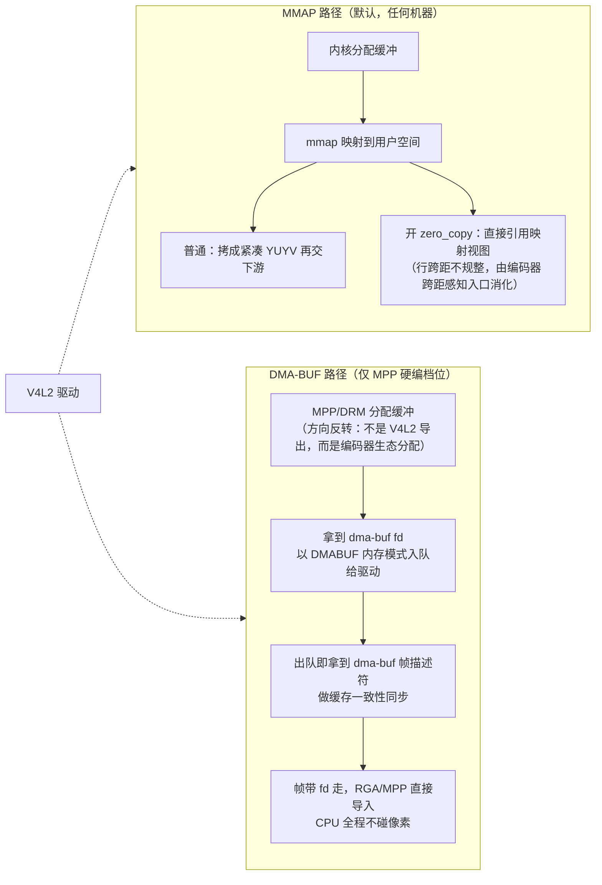

MMAP 是默认稳定路径：缓冲由内核分配、映射到用户空间，帧要么拷贝成紧凑格式交给下游（普通模式），要么在开零拷贝时直接引用映射视图不拷贝——不拷贝的代价就是前面说的行跨距不规整，由编码器的跨距感知入口来消化，视图入口因此能省一次全帧拷贝；当前应用以 x264 首建采集组时使用复制路径。DMA\-BUF 是全硬件路径，缓冲按以下方式分配：**缓冲不是从 V4L2 这边导出的，而是反过来用 MPP 和 DRM 的缓冲分配器创建，拿到 DMA\-BUF 的文件描述符之后，再以 DMABUF 内存模式入队交给采集驱动**。这样取帧时拿到的直接就是 DMA\-BUF 描述符，前后做一圈缓存一致性同步，然后帧带着描述符走，RGA 和 MPP 拿去直接导入当自己的缓冲——整条路上 CPU 没碰过一个像素字节。帧用完的归还是全自动的，靠的就是 base 模块里那个析构回调机制：队列丢帧、管线重启、异常路径，缓冲都自动回驱动，不漏不错还。

**第四个问题，曝光。** 曝光在流开启之前用 V4L2 的扩展控制接口写入，单位是 100 微秒。自动曝光通常要 10 到 30 毫秒，是端到端延迟里最大的单项，而且它不出现在任何统计分段里——它藏在传感器出帧的时刻，只能靠端到端差值去观察。手动压到 5 毫秒以内，通常能明显降低延迟中位数，是可以优先考虑的优化项。摄像头要是不支持手动曝光，只打一条警告，不挡启动。

这个模块自己不建线程，采集的节奏由上层流水线的采集泵驱动；它也不被别人直接实例化，而是通过工厂接口注入给流水线，测试时换成假采集源就能在没有摄像头的机器上跑整条管线——这正是它把接口和实现分开的原因。

### encoding：把画面编成 H.264 / H.265

encoding 是链路第二环，对外一个统一接口（初始化、强制关键帧、在线码率调整、按视图编码、关闭），内部有两条平级的独立链路，由 VideoEncoder 门面按配置创建后端，选哪条在启动时就定了，运行期不切换。两条链路的完整地图：

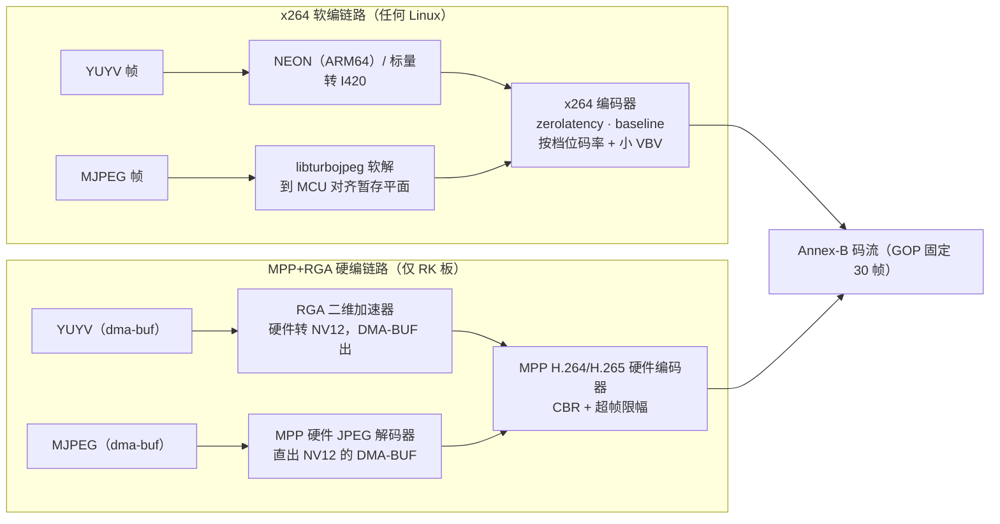

**软编链路**用 x264。摄像头出的 YUYV 画面先转成 x264 接受的 I420 格式，转换在 ARM64 上有 NEON 优化实现，普通机器走标量版本；如果采集的是 MJPEG，先用 libturbojpeg 软解到 MCU 对齐的暂存平面再进编码器。有个跨距感知的编码入口，能直接接收采集模块零拷贝模式映射出来的不规整视图，省一次拷贝——采集和编码通过这个视图接口传递数据。配置风格是 zerolatency 加 baseline profile，生产默认单编码线程并启用 sliced_threads，延迟和兼容性优先于压缩效率。以 yuyv_x264 为例，码控用平均码率目标 800k，配一个故意很小的虚拟缓冲上限（峰值 900k、缓冲 30 万比特）——那个虚拟缓冲模型配得越大，解码端就要预留越大的抖动空间，延迟就上去了，所以宁可小。强制出关键帧用一个原子标志，编码泵每帧检查。

**硬编链路**用 RK 芯片的 MPP 加 RGA，输入统一转成 NV12，这是嵌入式硬件链路的事实标准。YUYV 到 NV12 的转换不用 CPU，交给 RGA——RK 芯片上的二维加速器，负责格式转换和缩放，DMA\-BUF 进 DMA\-BUF 出，按任务建缓冲句柄；MJPEG 则用 MPP 自带的硬件 JPEG 解码器直接解到 NV12 的 DMA\-BUF 上。采集侧拿到的 DMA\-BUF 描述符直接导入编码器成为零拷贝缓冲，同一个缓冲重复导入有缓存表，不做重复的导入导出工作。硬件编码器的码率控制需要注意以下行为：**它的码率控制是区间目标，不是瞬时硬上限**，恢复场景出的关键帧实测能到四五十 KB 以上，这种突发会超过发送端的整形预算。解决办法是叠加超帧限幅：限制关键帧和非关键帧的大小比例在 2 到 8 之间，帧超过阈值就自动重编码，最多重一次，阈值按档位配置——比如 mjpeg_mpp 的关键帧重编码阈值 96KB、普通帧阈值 48KB。这套限幅逻辑使用独立于设备初始化的纯配置函数，没有 MPP 硬件的开发机也能对它做单元测试。编码时需要遵守以下限制：**绝不能用丢编码帧的方式来控码率**，丢参考帧整条解码链就花了，宁可重编码。

两条链路采用相同的处理要求。**GOP 固定 30 帧**，也就是 30 帧率下每秒一个关键帧，用于在丢包后恢复解码——最坏等一个 GOP 一定有定期关键帧。固定间隔不能只靠把最大最小间隔设成同一个值，x264 会自动把最小间隔钳到一半加一，而且场景切换检测默认开着、画面一变就中途插关键帧，真要固定间隔必须显式把场景切换检测关掉，这几个设置需要同时生效。**每帧编码耗时都在记录**，每 5 秒输出一次分位数摘要，软编和硬编的耗时对比、以及"编码是不是瓶颈"的判断全靠它——比如软编 1080p 的 p95 可能贴着帧间隔，硬编 p50 只有三五毫秒，余量充足，这就是当初决定上硬件链路的直接依据。最后还有个能力探测函数，纯软件构建里它返回不可用，服务端启动时据此把硬件档位从能力列表里过滤掉，客户端永远看不到自己跑不了的档——能力列表据此排除不可用的后端。

跟采集一样，这个模块不自建线程，跑在流水线的编码泵上，通过工厂注入、可以换假实现。

### transport：把码流推出去

transport 是链路第三环，负责媒体发送与网络反馈。当前媒体只有 UDP；加密、自动画质或自动网络策略会话独享传输，固定画质明文会话可按设备、活动档位和固定网络策略复用。传输对外仍提供接口：初始化、启动、停止、可中断的发送、关闭、广播一帧、查询绑定的端口。

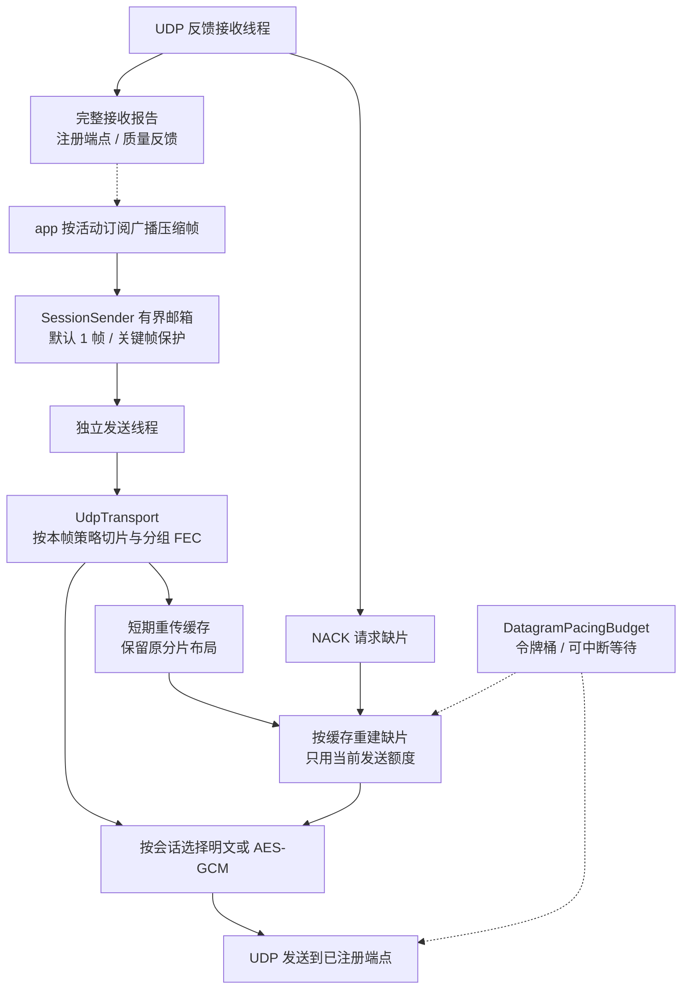

先说公共的东西。**UDP 使用一套自定义的二进制线路协议**：消息头 12 字节，开头 4 字节是个 magic 值用于流同步和校验，然后是长度和类型；消息包括保活、视频帧、重传请求和保活确认。每帧消息的头部带一段 40 字节的元数据，里面是一个帧号与四个时间戳，采集、编码开始、编码结束、发送时刻一路盖到帧上，客户端的分段延迟统计全靠这段元数据，能算出"网络花了多少、解码花了多少、渲染花了多少"，这是整个系统可观测性的地基。UDP 的分片头 84 字节，带帧内偏移、分片序号、总分片数、FEC 组号、逐包反馈信息和角色——角色区分数据片和前向纠错的校验片；客户端定期回传的完整接收报告 660 字节，带抖动、RTT 与恢复统计。所有字段的序列化都是显式按小端一个字段一个字段写的，不直接拷贝结构体内存，布局由编译期断言检查；客户端仓库里有一份镜像定义，两边用同一组黄金样本做一致性测试，保证两端定义一致——两个独立仓库共享线格式，需要使用相同样本验证序列化结果。

**UDP 实现**在每个传输实例内用一个 socket 服务其接收端，从合法的完整接收报告里"学习"并注册客户端，不搞每接收端一个 socket。发送侧把帧按档位拆分片（1200、1000 或 256 字节），开启前向纠错且预算允许时，按片号对实际组数 G 取余交织分组，每组额外发一个异或校验片；明文发包用 Linux 的批量发送接口加分散读写，协议头和载荷各占一段、零拷贝地拼成一个包，避免整帧内存的拼接拷贝。接收侧有一条线程专门收客户端的重传请求：每个请求最多重传 4 个分片，从重传缓存里按需重建再发，重传跟首发共享同一个整形额度但绝不等待。碰到内核缓冲满的报错（EAGAIN 或 ENOBUFS）就进从 20 到 200 毫秒的指数退避，退避期间丢新帧不排队——UDP 没有排队重发的语义，继续发送会加重拥塞。

发送还共用几件设施。**每个传输实例有一个专属发送线程和一个默认容量为 1 的信箱**，新帧入队时优先淘汰旧非关键帧，带 50 毫秒的过期丢弃和关键帧保护——广播方只投递、发送方按自己的节奏消费，隔离和节拍解耦都在这一层完成。**整形的令牌桶**很重要：出关键帧的时候一帧几十 KB，一口气全发出去会瞬间打满内核和 WiFi 的队列，造成的突发丢包丢的可能正是这个关键帧，所以按令牌桶额度（基础配置 10 兆比特每秒、突发额度 64 个包，ABR 可联动调整）整形着发；重传请求共享同一个额度，但重传侧的申请是"没额度立即放弃这一批"、绝不睡眠等待，因为重传跑在接收线程上，它不能为了等额度把收包循环卡住。**统一的 socket 选项工具**负责收发缓冲设置并读回验证（防止内核静默钳到别的值）、服务质量标记和 socket 优先级——控制通道的标记比媒体流高，主机分类策略支持时可让控制命令获得更高发送优先级；传输模块和控制服务共用这套工具，保证标记策略一致。

### pipeline：共享采集与多子流流水线

pipeline 负责组织媒体生产流程，一个叫 StreamProducer 的类拥有一个采集组的帧源和按档位独立的编码子流，同设备兼容请求共享采集，同档位共享编码。每组一条采集线程，每子流各一条编码和分发线程，N 路子流是 1+2N 条线程。结构如下图：

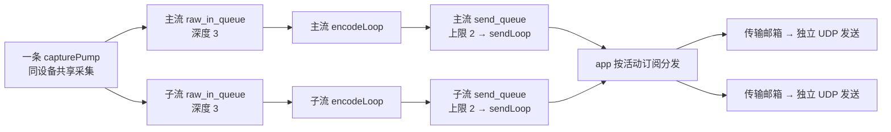

**中间需要用线程和队列分开处理，因为两个环节的节拍对不上。**摄像头按驱动协商的帧率匀速出帧，编码耗时是抖动的，软编尤其明显，直接调用就意味着编码慢的时候反向卡住采集线程——取帧不及时，驱动缓冲耗尽就开始丢帧，丢在哪一层完全不可控。通过线程和队列分开处理，两边按各自节奏运行，队列缓存处理速度不一致时积压的帧。发送侧同理：网络时快时慢，浅队列加丢旧策略，将网络等待限制在发送侧，不直接阻塞源头。

**丢帧在这个模块里分两种语义。** 队列满丢最旧，丢原始帧是安全的，编码器还没碰过它，顶多少一帧画面；但丢已经编码的帧会破坏 H.264/H.265 的参考链——后面所有依赖它的帧都解不出来，所以丢编码帧会触发那个带 500 毫秒冷却的恢复信号，让编码器尽快补一个关键帧补救，这个请求有最小间隔，防止多个会话同时请求关键帧造成发送端突发过大。沿一条活动子流，三级队列的深度从采集到网络依次是 3、2、1，**越靠近网络越浅**——这样设置是为了限制队列积压：网络抖动的余量逐级收窄，绝不让它反压到采集编码；同时每过一个环节，旧帧都更过时，接近发送出口时应及时丢弃过期帧。

这个模块还承担编码耗时的记录（有编码进展时至少隔 5 秒输出一条分位数摘要）和对外的关键帧请求入口——控制服务收到 KEYFRAME 命令，最终就是调到这里的请求方法，它把请求交给该会话当前的编码子流，编码循环尽快出 IDR，对共享该子流的会话生效。工程上有个贯穿的特点：**采集源和编码器都是通过工厂接口注入的**，测试的时候换成假实现，整条流水线就能在没有摄像头、没有编码器的开发机上跑起来验证——专门有一个管线启动测试就是这么跑的。

这个模块按以下顺序关闭：先摘除子流，锁外停止并回收子流编码和分发线程，再收采集线程、释放缓冲租约并关闭帧源；分发线程必须先于下游传输拆除退出，因为回调还可能引用传输；顺序反了就是use\-after\-free。

### control：文本控制协议服务

control 模块是常驻的控制服务，监听默认 9000 端口，逐行可见 ASCII 文本协议。它的职责边界很清楚：**只管协议和连接，不管业务**——命令解析出来之后转发给 contracts 定义的接口去执行，自己不知道会话和管线为何物。

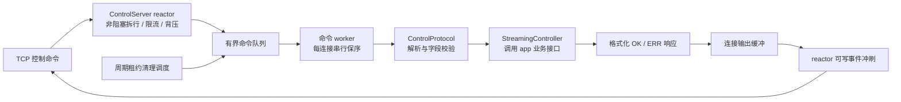

五个命令的语义：STATUS 必须带显式会话号，查询该会话并续租；CAPS 查能力，返回可用媒体档位白名单，纯软件构建的返回值里自然没有硬件档；START 带会话号、传输方式、端口（传 0 表示让服务端动态分配）、网络策略、画质、加密请求和可选的设备、媒体档位；STOP 必须带会话号、幂等；KEYFRAME 显式寻址该会话当前的编码子流。响应统一是"OK 加全套状态字段"或"ERR 加错误码和消息"——不管执行的是哪个命令，**每条响应都带全套状态字段**：当前状态、传输方式、主机、端口、网络策略和活动媒体档、会话号、codec 和设备；密钥只随成功 START 返回。这让每条响应自包含，客户端的原则是不信自己的预期、只认服务端回传的实际值：媒体端口是服务端动态分配的，档位也可能被服务端规范化过，拿到响应直接用里面的字段，不需要再发一条查询确认，也就不存在"请求成功但状态对不上"的竞态窗口。

协议解析严格校验输入：未知命令、未知键、重复键、控制字符一律拒绝，单行上限 1024 字节，10 秒滑动窗口里超过 64 条命令当作洪泛直接断开，控制连接上限 16 个。命令只改内存里的对象，不会执行命令文本、不碰 shell、不写回配置文件。这里使用文本而没有使用 JSON 或 protobuf：命令就五个、全是简单键值对，文本够用，拿 nc 就能手工调试，管道里 echo 一条命令就能测，依赖为零，适合减少嵌入式环境中的依赖。解析和格式化全部是纯函数，有完整的单元测试覆盖——未知输入、边界值、格式化往返，这些纯逻辑可以直接验证。

**并发结构是"一个反应器线程加一个小的命令工作线程池"**：反应器线程管监听和全部连接的读写，命令的执行放到默认 2 个工作线程上，从一个有界命令队列里取活。分开的原因很具体：START 命令要初始化编码器、可能要等摄像头出帧，是秒级的耗时操作，绝不能占住管输入输出的线程——它一卡，所有客户端的命令全堵。连接背压的处理如下：**一条连接有命令还在执行的时候，把它的可读事件从反应器上摘掉**——不摘的话水平触发模式下内核缓冲还有数据就一直就绪、一直空转唤醒；摘掉之后，这条连接后续的命令字节堆积在内核接收缓冲里，缓冲满了对端的发送自然就被内核顶住了，命令处理完再把事件加回来。这等于借内核的接收缓冲做了一层命令级背压，连接状态仍由锁保护。每条连接内部有"忙标志加待处理行队列"，忙时新到的行先排队，执行完再取。会话租约的超时扫描也挂在这个模块：反应器每次等待的间隙跑一次周期回调，发现过期没续租的会话就丢给工作线程去回收。

### app：会话统筹和程序入口

app 模块干两件事：ServerApp 类实现控制面接口，是所有命令的真正执行者；main 函数是服务端可执行文件的入口。会话的流转状态如下：

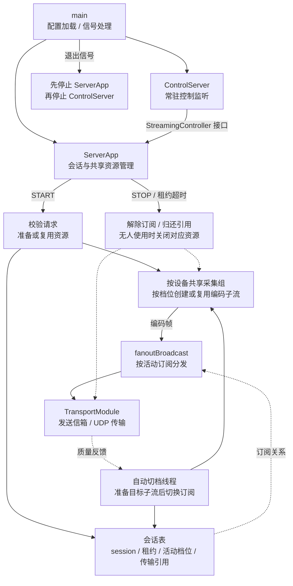

**ServerApp 的多会话模型是理解服务端的关键。** 它内部维护一张会话表，每个会话是一个结构体，记着传输引用、绑定端口、会话号、活动档位和最近续租时间。每个会话独立启停，媒体只走 UDP；同设备兼容请求共享采集，同档位共享编码，传输按条件独享或复用。会话的启停归还自己的资源引用；**换档位先准备目标子流，再切换本会话订阅**——创建或复用目标编码器，成功后在目标关键帧边界切换，归还旧流引用；失败保留当前流。其他会话继续使用自己的订阅，不重启共享采集。帧的扇出是个简单直接的函数：按活动订阅把编码帧塞进对应传输的发送信箱，不做任何网络操作。**会话靠租约管理生命周期**：启动和每次状态查询都算续租，超过 30 秒没续租就回收会话、释放端口，档位无人使用才停编码，该设备全部子流退出后停采集——这解决的是客户端崩溃或断网时没机会发停止命令的问题，服务端不能一直为已退出的客户端保留端口。请求进来会先做一次规范化（档位名对不对、传输方式合法吗、端口范围对不对），再进入执行。

**并发用两把锁**：一把保护秒级的长操作，比如启停管线、换档，持有时间以秒计；另一把保护状态读取和扇出快照，持有时间以微秒计。长操作不阻塞扇出，扇出不阻塞读状态——如果只有一把大锁，一个客户端换档的那一秒，所有人的画面帧都发不出去。

**main 函数的流程**如下：解析配置路径和覆盖参数；在创建任何线程之前先屏蔽退出及 SIGHUP 信号，忽略管道破裂信号——先屏蔽再建线程，信号就不会随机命中某个工作线程，之后主线程用同步等待的方式等信号送达，代码里就没有到处都是的异步信号处理；装载校验配置，按硬件能力过滤档位白名单；构造 ServerApp 和控制服务，把前者的接口指针交给后者，启动监听 9000 端口；主线程等待信号，SIGHUP 重读并应用允许的配置子集后继续等，退出信号到来就先停应用再停控制服务，日志定稿退出。**媒体端口完全不在这个流程里**——它们是各会话 START 之后由传输实例按需绑定的，配置里那个监听端口只是历史缺省值。

app 是全仓库唯一同时看见"管线"和"会话表"这两个概念的地方，命令借控制模块的工作线程执行，媒体处理由流水线和传输线程执行，应用另有自动切档线程。通过它可以看到服务端各模块的调用关系。

---

## 双端串联说明

### 一帧的端到端过程

把两个程序连起来，一帧画面从摄像头感光到屏幕发光的完整路径：

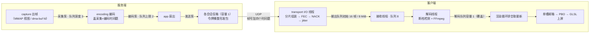

一帧图像依次经过以下处理。**服务端这边**：采集模块从驱动拿到一帧原始画面——CPU 路径可复制或引用映射，硬件路径可以是一个 DMA-BUF 描述符，帧对象身上挂着析构归还的钩子，最后一个持有者释放时归还缓冲；共享采集泵把引用投到各子流第一个队列，深度 3，满了丢最旧。编码泵取出来，软编先转格式再压成 H\.264，硬编经二维加速器转 NV12 后编码 H.264/H.265，出来的码流带着序列号和一路时间戳进第二个队列，上限 2。发送泵取出帧，通过扇出回调把它塞进订阅对应传输实例的发送信箱——容量 1，慢的会话只会在自己这儿丢帧；发送线程按令牌桶的额度把帧发上网络，帧头里带着帧号和四个时间戳。**客户端这边**：输入输出线程收到包，UDP 模式下先按位图组装分片，缺片先用逐组异或纠错补，补不了按预算节奏发重传请求等对端补发，凑齐的完整帧在抖动缓冲里等到期出帧；完整帧经过有界队列交付。接收线程拉到帧，进容量 8 的接收队列。解码线程检查序列号，没断档就喂给 FFmpeg，解码出的画面进容量 1 的解码队列——中间的帧被覆盖，只留最新。主线程的渲染循环取走最新帧，发布进单槽邮箱，绘制事件里从邮箱取出来，经 PBO 双缓冲上传纹理或从 macOS IOSurface 导入图像，着色器完成颜色转换，画面上屏；统计面板每 100 毫秒刷新一次这趟旅程的分段耗时。

一路数下去：服务端三级队列 3、2、1，客户端 8、1、单槽邮箱——**越靠近两端的出口越浅，全链路要最新不要排队**，延迟不随网络抖动累积，这些队列限制共同控制链路中的帧积压。按项目里的分段统计，端到端延迟的大头是摄像头曝光和编码器，打包、传输、接收这些代码只占几毫秒——所以优化方向是手动曝光和硬件编码，而不是继续压缩收发代码的耗时。

### 线程全景

两个程序的线程合在一起看：

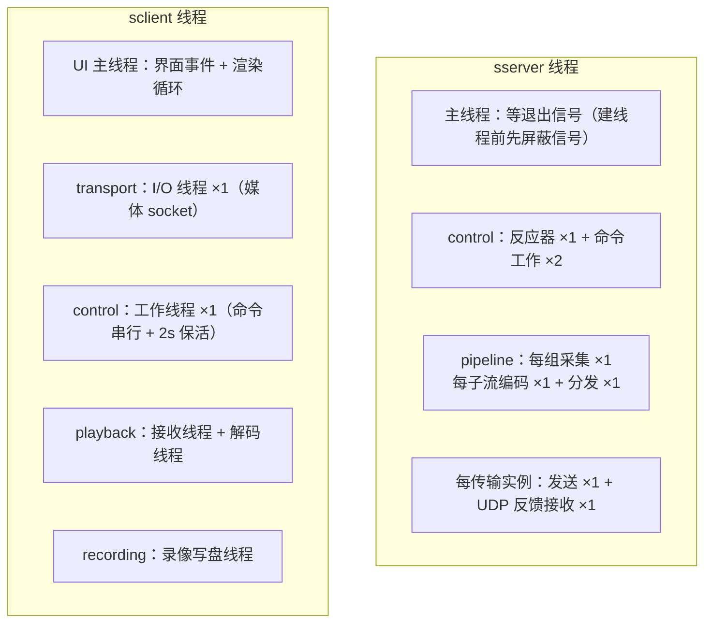

服务端的线程数量取决于启用的功能和实际运行的资源实例。这里统计项目代码管理的线程，**包含主线程，不包含编解码库内部线程**。

| 线程 | 数量 | 创建条件和职责 |
|---|---|---|
| 主线程 | 1 | 程序入口，等待退出或 SIGHUP 重载信号 |
| 控制 I/O 线程 | 1 | 运行 EpollReactor，处理控制连接的读写事件 |
| 控制命令 worker | 默认 2 | 执行 START、STOP、STATUS 等命令，数量由 control.workers 决定 |
| 采集线程 | 每个活跃采集组 1 条 | 从该设备取得原始帧，交给本组编码子流 |
| 编码线程 | 每个活跃编码子流 1 条 | 对本子流的输入帧进行编码 |
| 子流分发线程 | 每个活跃编码子流 1 条 | 取出编码帧，经 app 投递到对应传输信箱，不在这里等待网络发送 |
| UDP 发送线程 | 每个传输实例 1 条 | 消费发送信箱，执行分片、FEC、pacing 和发送 |
| UDP 反馈接收线程 | 每个传输实例 1 条 | 接收质量报告，处理 NACK 和重传 |
| 自动画质切档线程 | 0 或 1 | 第一次需要自动切换主子流时创建；之后保留，即使当前没有切档也计入 |
| systemd 看门狗线程 | 0 或 1 | WATCHDOG_USEC 为正时创建，周期发送心跳 |

**默认 2 个命令 worker 时，固定部分是 4 条：主线程 1＋控制 I/O 1＋命令 worker 2。** 在此基础上，按实际资源继续相加：

`总数 = 4 + 采集组数 + 2 × 活跃编码子流数 + 2 × 传输实例数 + 自动画质切档线程数 + 看门狗线程数`

例如，不启用看门狗时：

| 运行场景 | 计算 | 合计 |
|---|---|---:|
| 刚启动、尚未观看，也未创建画质切档线程 | 固定部分 4 | 4 条 |
| 单摄像头、1 路编码子流、1 个传输实例，未创建画质切档线程 | 4＋采集 1＋编码/分发 2＋UDP 收发 2 | 9 条 |
| 上述观看场景，自动画质切档线程已经创建，当前只保留1路编码子流 | 9＋画质切档 1 | 10 条 |
| 同一自动会话切档期间，新旧两路编码子流暂时并存，传输实例仍为1个 | 10＋目标子流编码/分发 2 | 临时 12 条 |

启用看门狗后，上述数量再加 1。每多一个实际运行的采集组加 1，每多一路编码子流加 2，每多一个传输实例加 2；**按资源实例计数，不按观看人数直接相乘**，因为多个会话可能共享采集、编码或符合条件的明文传输。自动网络策略在已有 UDP 反馈线程中更新，不会另起一条线程；FdEventWaiter 也在采集线程中等待，不额外创建线程。

客户端播放主链路主要是五条线程：UI 主线程兼任渲染循环；输入输出线程包揽媒体 socket 和收包处理；控制工作线程串行执行命令并做 2 秒一次的保活；接收和解码两条线程由播放层管理。录像时另有写盘线程，连接期间还可能有临时线程。

**线程之间的交接只有三种形态**：满时丢最旧的有界队列、覆盖式的单槽邮箱、取走即清的原子标志。没有跨线程裸共享可变状态，队列、连接表和资源状态由各自的锁或原子变量保护。关闭时需要按顺序停止各部分：服务端先收子流编码和分发线程，再收采集线程，发送线程必须先于传输层拆除，因为它持有传输的引用；每个文件描述符有唯一的属主和唯一的关闭路径，先从事件循环注销、再关闭，用原子标记保证只执行一次。按上述顺序处理，可以在正常关闭和异常退出时回收线程、文件描述符和缓冲资源。

### 总结

服务端：base 管帧长什么样和线程怎么交接，通过析构回调归还零拷贝缓冲；logger 用结构化日志让一次故障能按会话串成时间线；reactor 管控制事件与采集设备等待，文件描述符在关闭前先从事件循环注销；appconfig 把唯一一份配置严格地装进来，档位继承让设备与画质分家；contracts 用一个接口把协议和实现切开，几十行看完控制面全貌；capture 从摄像头拿画面，CPU 路径可复制或引用映射，硬路可走 DMA-BUF 反向分配，帧析构自动还缓冲；encoding 双后端编码，软编通用、硬编省 CPU，GOP 固定 30 帧加超帧限幅，绝不丢编码帧控码率；transport UDP 推流，靠容量 1 的信箱隔离慢客户端、靠令牌桶控制关键帧突发发送；pipeline 按采集组与编码子流组织，三级队列 3、2、1 逐级收窄，丢编码帧必触发补关键帧；control 只解析协议不执行业务，一个反应器带一个小线程池，忙连接摘事件借内核缓冲背压；app 是唯一同时看见管线和会话表的地方，自动换档切本会话订阅，不重启其他会话采集，租约替崩溃的客户端收尾。
客户端：base 管解码帧和交接工具，单槽邮箱只保留最新值；logger 跟服务端对齐，两边日志能拼成一条时间线；transport 收流加四层弱网恢复，媒体 socket 收敛在一条 I/O 线程，恢复等待受预算约束；control 把文本命令变成可等待的结果还管保活和显式会话释放；decoding 是 FFmpeg 软硬解码的薄封装，刷新方法用于断档重同步，诊断字段稳定可 grep；rendering 用 PBO 或 IOSurface 和着色器避免 CPU 转 RGB，GPU 对象常驻只更新内容；ui 靠待决请求队列避开跨线程控件，统计面板 100 毫秒一刷；cli 是共享的参数解析库而不是播放器，一份配置结构从命令行贯通到收包循环；playback 负责播放编排，断档检测、停帧优于花屏、三个纯函数策略文件都在这；app 把全流程串起来，断流时先问服务端再决定怎么恢复，恢复空转三轮就转人工。
